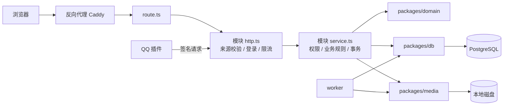

# ArtZoo 架构

本文介绍代码怎么分层、一个请求怎么流转、关键数据规则落在哪里、后台任务做什么，以及有哪些配置开关。业务结构基于代码版本 `fa643541` 整理；第九节的部署交付流程以当前 Dockerfile 和脚本为准。

业务规则（例如退出扣几分）不在本文范围内，请看 `rules/`。

---

## 一、模块

| 位置 | 职责 | 依赖 |
|---|---|---|
| `apps/web` | Next.js 页面、全部 API 接口、服务端业务逻辑与鉴权 | domain、db、media |
| `apps/worker` | 独立的后台进程，每 30 秒运行一轮维护任务 | domain、db、media |
| `packages/domain` | 前后端共用的类型、校验、错误码、北京时间等规则 | 无 |
| `packages/db` | Prisma 数据库结构与迁移、数据库连接、各类维护任务、抽奖资格、QQ 投递队列 | domain |
| `packages/media` | 图片解码、去除元数据、本地存储、孤儿图片清理 | domain、db |
| `plugins/astrbot_plugin_artzoo` | QQ 机器人插件（Python），通过带签名的接口和网站通信 | 独立运行 |

### `apps/web` 内部的分层

- `app/api/**/route.ts`：只负责把请求转给对应模块，不写业务逻辑。
- `server/<模块>/http.ts`：校验请求来源、读取请求体、检查登录、限流、把错误转成 HTTP 响应。
- `server/<模块>/service.ts`：业务规则、权限与归属判断、数据库事务。

这是各模块约定俗成的写法，并不是框架强制的结构。新增功能时，参照同一个模块里已有的代码来写。

### 页面路由分组

括号目录不会出现在网址里。

| 位置 | 作用 |
|---|---|
| `app/layout.tsx` | 根布局：AntD 样式注册、全站 Provider；默认不允许搜索引擎收录 |
| `app/(site)/layout.tsx` | 站点外框：背景、公告栏、"跳到正文"链接 |
| `app/(site)/(public)/` | 不需要登录的页面：首页、资源、精选、登录、邀请注册 |
| `app/(site)/(protected)/` | 需要登录的页面：活动、相册、日常、知识库、抽奖、心愿、成员、固定队、个人中心、后台 |
| `app/help-demo` | 使用引导的演示页，不在上面任何分组里 |

`(protected)` 分组的布局只负责读取会话、把会话传给前端，**它本身不会拦截未登录的访问**。真正的拦截靠每个页面自己调用 `server/auth/page-guards.ts` 里的守卫函数：

- `requirePageAccount`：要求已登录。
- `requirePageAdministrator`：要求是管理员。
- `requirePageSuperAdministrator`：要求是超级管理员。

目前这一组下的 50 个页面都调用了守卫。

---

## 二、请求怎么流转



以写操作（POST/PUT/PATCH/DELETE）为例，`http.ts` 会按顺序做以下几件事：

1. **来源校验**：调用 `validateOrigin`（在 `server/auth/http.ts`），以下条件必须全部满足：
   - `Origin` 等于站点配置的地址；
   - 请求头带有 `x-artzoo-request: 1`；
   - `Sec-Fetch-Site` 不是 `cross-site`；
   - `Content-Type` 是 `application/json`。

   上传接口使用各模块自己的同类校验函数。
2. **读取请求体**：每个模块都有大小上限，比如账号模块是 8 KB。
3. **读取会话**：从 Cookie 中取出 token，到数据库查会话，并检查账号是否已被停用。
4. **限流**：来源 IP 由 `resolveRequestSource` 确定。
5. **调用 service**：在 service 里判断权限和归属，然后执行事务。

`/api/health` 是唯一不经过上述流程的接口。

### 登录、会话与权限

- **两套身份互相独立**：参与身份 `membership` 分为正式成员（MEMBER）和朋友（FRIEND）；管理角色 `adminRole` 分为 NONE、ADMIN、SUPER_ADMIN。不能从参与身份推出管理权限。
- **密码**：用 scrypt 哈希保存，比对时用 `timingSafeEqual`。如果手机号不存在，也会拿一个假哈希完整比对一遍，让响应时间和存在时一样。
- **会话**：token 随机生成，数据库里只存它的哈希，有效期 30 天。改密码或重置密码后，该账号的所有会话都会作废。
- **Cookie**：始终带 `HttpOnly` 和 `SameSite=Lax`。
  - 生产环境要求站点地址是 https，Cookie 名为 `__Host-artzoo-session`，并带 `Secure`。
  - 本地开发时只允许 localhost 访问，Cookie 名为 `artzoo-session`。
  - `ARTZOO_DEPLOYMENT_ENV` 只能是 `production` 或 `local`，填其他值时服务直接返回 503。
- **邀请链接**：数据库保存 token 的摘要。如果配置了 `ARTZOO_INVITATION_KEY`，还会额外保存一份 AES-256-GCM 加密的密文，这样管理员之后还能再次查看这条链接。
- **短信**：`ARTZOO_SMS_PROVIDER` 默认是 `unconfigured`，这时发短信的接口返回 503。目前只支持阿里云号码认证服务（`aliyun-pnvs`）。
- **页面守卫与接口鉴权要分开看**：前端把按钮隐藏，不等于有了权限控制。每个接口都必须在服务端自己检查。

### 限流

限流记录保存在数据库表 `AccountRateEvent` 里，按 15 分钟一个窗口计数：

| 桶 | 上限 |
|---|---|
| 同一来源的写操作 | 300 次 |
| 同一账号的写操作 | 60 次 |
| 全站写操作 | 10000 次 |
| 同一手机号 + 同一来源的登录 | 10 次 |
| 同一手机号的登录 | 50 次 |

"来源"由 `server/auth/request-source.ts` 决定：

- 只有在 `ARTZOO_TRUSTED_PROXY=caddy` 时，才读取 `X-Forwarded-For` 的**最后一段**作为来源。IPv4 按单个地址计算，IPv6 按 /64 网段计算。
- 其他情况下，所有人都算作同一个来源 `untrusted-source`，**全站共用一个桶**。

所以，生产环境如果放在 Caddy 后面，必须设置 `ARTZOO_TRUSTED_PROXY=caddy`；新部署方式也要确保代理会覆盖 `X-Forwarded-For`。如果新部署不使用 Caddy，需要修改这个文件。

### 安全响应头

定义在 `apps/web/security-headers.ts`，对所有页面生效：

- `default-src 'self'`
- `script-src 'self' 'unsafe-inline'`（没有使用 nonce）
- `img-src 'self' data: blob:`
- `frame-ancestors 'self'`
- `X-Frame-Options: SAMEORIGIN`
- `Referrer-Policy: no-referrer`
- `X-Content-Type-Options: nosniff`

### 错误与日志

- **业务错误**：抛出 `AccountError`，带错误码、中文提示和 HTTP 状态码。
- **意料之外的错误**：由 `server/http-error-log.ts` 的 `logUnexpectedHttpError` 输出一行 JSON 日志，只记录路由名、错误名和错误码。不记录 message、stack、请求体、手机号或 token。
- **Next 自身的请求错误**：通过 `instrumentation.ts` 也走同一个函数。

---

## 三、数据库

### 连接

- 数据库客户端只能通过 `getDatabase()`（在 `packages/db/src/index.ts`）获取，它在进程内只创建一次。
- 连接池参数在 `packages/db/src/pool-health.ts`：

| 参数 | 值 |
|---|---|
| 连接数上限 | `PG_POOL_MAX`，默认 web 10、worker 3 |
| 获取连接超时 | 3 秒 |
| 单条语句超时 | 15 秒 |
| 等锁超时 | 10 秒 |
| 事务空闲超时 | 30 秒 |
| `application_name` | `artzoo-web` / `artzoo-worker` |
| 会话时区 | 强制 UTC |

- `/api/health` 复用同一个连接池做 3 秒探测，只返回 `{ ok: true/false }`。

### 事务与锁

- **写事务**：统一使用 `ReadCommitted` 隔离级别，`maxWait` 5 秒，`timeout` 15 秒。**只读的列表和快照**多数使用 `RepeatableRead`。
- **锁**：同一对象的并发修改，用 `lock(tx, '类型:id')` 串行处理，底层是 PostgreSQL 的 `pg_advisory_xact_lock`；只读路径用 `lockShared`。这两个函数定义在 `apps/web/server/auth/service.ts`。`packages/db` 里的维护任务各自有一份私有的同名函数，使用同一个哈希命名空间。
- **重试**：`packages/db/src/transaction-retry.ts` 遇到死锁或序列化冲突时会自动重试，但调用方必须显式声明"这个事务可以安全地重放"。目前只有限流使用了它。
- 设计取舍见 [ADR-0001](adr/0001-postgresql-coordination.md)。

### 只写在迁移 SQL 里的规则

有些规则 `schema.prisma` 表达不了，只能写在迁移的 SQL 里。改动下表中的任何一项，都要先找到对应的 SQL 看清楚：

| 规则 | 实现 |
|---|---|
| 每人在同一个活动里，最多只有一条有效报名 | 部分唯一索引 `ActivityRegistration_active_account_key`（`WHERE status='ACTIVE'`）。固定队有同类的 `TeamMembership_active_account_key` |
| 报名的席位必须属于这个活动或这支队伍 | 复合外键 `ActivityRegistration_seatId_activityId_fkey`、`TeamMembership_seatId_teamId_fkey`、`TeamApplication_seatId_teamId_fkey` |
| 积分每次变动都留流水，不重复计分 | 表 `ActivityScoreChange`：`eventKey` 唯一，处罚和完成记录各自唯一，并记录变动前后的值。`packages/db/src/activity-standing.ts` 先锁住账号行，再更新积分 |
| 已发布的抽奖参数和开奖结果不能改 | 触发器 `Lottery_immutable`，加上"已开奖时必须有结果"的 CHECK 约束。函数定义在初始迁移 `20261111000000_init` 里，其中包含"违规删除"这一种允许的变更 |
| 抽奖资格依据开奖那一刻的历史记录 | 表 `LotteryAccountFact` 等，配有一组禁止修改、禁止删除的触发器。详见 [ADR-0002](adr/0002-immutable-lottery-results.md) |

### 规模与约定

- 127 个 model、16 个 enum。旧站的 68 个迁移已在阶段 3 合并为一个初始迁移 `20261111000000_init`；完整结构（含上表这些规则）另记在 `packages/db/prisma/schema-snapshot.txt`，数据库测试会检查两者一致。
- 所有时间字段都是 `timestamptz`。
- 外键默认是 `Restrict`，删除业务数据时，多数情况用"删除标记"代替真正的物理删除。

---

## 四、后台任务（worker）

入口是 `apps/worker/src/index.ts`，每 30 秒运行一轮。每一步单独执行：某一步失败会被记录到 `failedSteps`，下一步照常执行。

| 步骤 | 做什么 | 开关 |
|---|---|---|
| activity | 处罚点数自然减免；缺人的活动到点自动取消；长期活动的首期成团或取消；自动记未到场；活动正常完成后减分 | 始终运行 |
| lottery | 把符合资格的人自动纳入抽奖；到时间开奖；补发没有发出去的结果通知 | 始终运行 |
| officialEvents | 采集官方活动，放进待审核列表 | `ARTZOO_OFFICIAL_SYNC_ENABLED=1`，默认关；采集间隔固定 24 小时 |
| mediaReservations | 清理已经过期的图片上传预留 | `ARTZOO_MEDIA_BUDGET_ENABLED=1`，默认关 |
| mediaOrphans | 删除没有挂到任何内容上的图片 | 预算开关和 `ARTZOO_MEDIA_CLEANUP_EXECUTE=1` 都打开才运行，默认关 |
| cleanup | 每天一次：删除 1 天前的限流记录，以及过期或作废超过 7 天的会话和验证码 | `ARTZOO_SECURITY_CLEANUP_ENABLED=1`，默认关 |

- **停止**：收到 SIGINT 或 SIGTERM 后，worker 会先等当前这一轮跑完，再断开数据库连接，然后退出。
- **运行参数**：`--once` 只运行一轮；`--require-db` 表示没有配置数据库时直接报错退出。
- **QQ 消息不由 worker 发送**：由 QQ 插件主动来网站领取，见第六节。

---

## 五、图片与文件

- **存储位置**：只用服务器本地磁盘，见 `DECISIONS.md` 第 2 条。
  - 生产环境默认写到 `/app/storage/original/<类别>`（原图）和 `/app/storage/derived/<类别>`（缩略图、预览图）。每个类别都可以用 `ARTZOO_<类别>_ORIGINAL_DIR` / `_DERIVED_DIR` 单独指定。
  - 头像目录用 `ARTZOO_AVATAR_DIR` 指定，必须是绝对路径。**生产环境一定要设置它**，否则会退回到仓库下的 `.local/avatars`。
- **删除后的文件**：相册照片被删除（单张、批量或整个相册）后，原图、预览图、缩略图三个文件也会被删掉，仍是其他相册封面的照片除外。开着上传配额时先核对文件是不是当初上传的那个再删，并把容量还给配额；配额关着时按照片 ID 直接删。删除失败的照片可以在相册里查看进度并重试（`albums/service.ts`、`packages/media/src/stock-retirement.ts`）。
- **上传并发**：`withUploadSlot` 控制同时上传的请求数，用 `ARTZOO_UPLOAD_CONCURRENCY` 设置，范围 1–8，默认 2，超过时返回 503。`withPhotoSlot` 控制同时进行的图片解码，固定为 2。
- **校验与处理**：
  - 按文件头判断格式，不接受 SVG。
  - sharp 处理时设置了像素上限和超时。
  - 单张照片最大 30 MB，头像最大 10 MB。
- **去除元数据**：原图保存前，用 `packages/media/src/metadata-strip.ts` 去掉 EXIF、GPS 等信息，只保留图片方向。
- **读取**：每次读取图片都要先经过业务权限检查。私有图片的响应头是 `Cache-Control: no-store`。
- **上传配额**：开启 `ARTZOO_MEDIA_BUDGET_ENABLED` 后才生效，默认全站总量 10 GB，每天 2 GB（按北京时间计算日期）。

---

## 六、QQ 机器人

- **网站这一侧**（`server/qq-official`、`server/bot-management`、`packages/db/src/qq-official-notifications.ts`）负责：账号绑定、在群里报名时的事务处理、通知排队、签名校验。
- **插件这一侧**（`plugins/astrbot_plugin_artzoo`）定时向网站领取待发送的消息，调用 QQ 发送，然后把结果回报给网站。
- **防止重复发送**：
  - 领取消息时有 30 秒租约和版本号（fence）。
  - 插件在本地 SQLite 账本里记录每一次发送。
  - 如果发送结果不确定，标记为 UNKNOWN，**不会自动重发**。

  详见 [ADR-0003](adr/0003-qq-uncertain-delivery.md)。
- **通信安全**：所有请求都使用 HMAC-SHA256 签名，并带时间窗口和 nonce 去重。密钥是 `ARTZOO_QQ_BRIDGE_SECRET`。
- **默认关闭**：`ARTZOO_QQ_MODE` 默认未设置。真实发送需要同时满足多项配置，见第八节。

---

## 七、公开页面与搜索引擎

- **robots**（`app/robots.ts`）：只允许搜索引擎收录首页和资源页，以及它们需要用到的静态资源，其他页面一律禁止收录。注意 robots 只是告诉搜索引擎别收录，并不是访问控制。
- **分享卡片（OG）信息**：`server/public-metadata` 只为游客本来就能看到的精选照片生成。它以游客身份读取数据，不带任何会话；读取失败时，返回不允许收录的通用信息。站点地址只读 `ARTZOO_PUBLIC_ORIGIN`。

---

## 八、配置开关一览

| 变量 | 默认 | 说明 |
|---|---|---|
| `ARTZOO_DEPLOYMENT_ENV` | 无 | 只能是 `production` 或 `local` |
| `ARTZOO_PUBLIC_ORIGIN` | 无 | 站点地址，生产环境必须是 https |
| `ARTZOO_TRUSTED_PROXY` | 空 | 生产环境放在 Caddy 后面时，设为 `caddy` |
| `ARTZOO_INVITATION_KEY` | 无 | 不设置就无法生成邀请链接 |
| `ARTZOO_SMS_PROVIDER` | `unconfigured` | 设为 `aliyun-pnvs` 才能发送短信 |
| `ARTZOO_AVATAR_DIR` | 仓库下的 `.local/avatars` | 生产环境必须设置为绝对路径 |
| `ARTZOO_UPLOAD_CONCURRENCY` | 2 | 同时上传的请求数，范围 1–8 |
| `ARTZOO_MEDIA_BUDGET_ENABLED` | 关 | 上传配额 |
| `ARTZOO_MEDIA_CLEANUP_EXECUTE` | 关 | 真正删除孤儿图片 |
| `ARTZOO_SECURITY_CLEANUP_ENABLED` | 关 | 每天清理过期的认证记录 |
| `ARTZOO_OFFICIAL_SYNC_ENABLED` | 关 | 自动采集官方活动 |
| `ARTZOO_QQ_MODE` | 未设置，即关闭 | `simulation`（只能在本地使用）或 `live`。`live` 模式还需要真实发送开关、测试群确认、APP_ID / BOT_ID / 群 openid、启用时间等多项配置，详见 `packages/db/src/qq-official-config.ts` |
| `ARTZOO_QQ_BRIDGE_SECRET` | 无 | 网站和插件之间通信用的签名密钥 |
| `PG_POOL_MAX` | web 10 / worker 3 | 数据库连接数上限 |

第 5 阶段写部署配置时，会按本表逐项确定新站的取值。

---

## 九、部署镜像与交付

开发和运行分离：开发端保留仓库并构建镜像，运行端只安装 Docker，接收发布包和运行配置，不拉取源码，也不需要安装 Node、pnpm 或 Python。家庭部署可使用同一台 Windows 上的两个独立 WSL；以后 Linux 服务器沿用相同发布包格式。

`Dockerfile` 提供三个目标：

| 镜像 | 内容与用途 |
|---|---|
| web | Next standalone、静态资源、独立 BMP 线程及其生产依赖 |
| worker | 编译后的后台程序及独立生产依赖，默认要求数据库配置 |
| tools | Prisma CLI、迁移、编译后的共享包和受保护的超管初始化入口；默认启动只显示说明 |

镜像使用同一 Node 基础镜像和锁文件，以 UID/GID 1000 运行。`.dockerignore` 只允许构建输入进入上下文，排除宿主依赖、私有配置、密钥和运行数据。媒体持久化由运行配置负责，镜像中不包含上传数据。

### 开发端：构建发布包

在开发仓库根目录执行，脚本会在需要时请求本机 Docker 的 sudo 权限；不要给整个脚本加 sudo。依赖 Bash、Git、Docker Buildx 和常用 GNU 工具，不依赖宿主 Node。

```bash
# 正式候选包：必须是干净工作区，默认输出三个镜像。
bash scripts/deployment-images.sh build --output "$HOME/artzoo-releases"

# 开发验证：允许未提交改动，只输出 web 镜像。
bash scripts/deployment-images.sh build --output "$HOME/artzoo-releases" --target web --allow-dirty
```

脚本构建后先运行基础检查，再导出镜像。输出目录必须在仓库外；每次生成独立版本目录和镜像标签，不覆盖已有发布包。`--target` 支持 `all`、`web`、`worker`、`tools`。允许未提交改动或只输出部分镜像的包使用 `dev-` 标签，不能当作可按提交重建的正式候选包。

完整发布目录包含 `images.tar`、`images.tsv`、`source.txt`、`SHA256SUMS`、镜像检查脚本，以及 `compose.yaml`、`.env.example`、`images.env`、`deployment-compose-check.sh`。运行模板源文件在 `deployment/`；`images.env` 从镜像清单生成，导入时逐项核对，不能自行改成 `local` 或其他版本。所有交付文件都参与 SHA-256 校验。`source.txt` 记录提交、工作区状态、目标及平台；包内没有真实密码或已填写的环境配置。部分镜像包仍可单独检查，但不能启动完整 Compose。

构建会占用 CPU、内存和磁盘；失败时不会发布最终目录，会报告保留的 `.artzoo-build.*` 临时目录，核对后可手动清理再重试。已构建的镜像和缓存不自动删除。旧格式包仍可导入和执行原有镜像检查；Compose 验证需要新格式完整包。

### 运行端：导入与验证

将整个发布目录复制到运行端。家庭 WSL 可以直接读取 Windows 共享盘上的目录；远程服务器通过 SSH/SCP 传输到操作者选择的发布目录。不要只复制 `images.tar`。下列 `bundle` 应替换为实际目录；命令可以在运行端任意目录执行。Compose 操作另外需要 Docker Compose 插件；隔离检查还需要 curl。

```bash
bundle=/srv/artzoo/releases/实际发布包目录
bash "$bundle/deployment-images.sh" import "$bundle"
bash "$bundle/deployment-images.sh" check "$bundle"
```

导入先校验固定文件清单及 SHA-256，再加载镜像并核对 ID 和平台；已存在相同 ID 的版本可重复导入，不同 ID 的同名标签会被拒绝。校验失败时重新传输，不绕过检查。校验只能检查传输完整性，不是发布者签名，发布包必须来自可信开发端。

基础检查使用临时容器，验证 UID、应用目录中的私有配置与运行数据、BMP 转换和损坏图片拒绝、web HTTP/静态资源/图片优化、worker 数据库依赖及缺库拒绝、tools CLI 与初始化入口保护。web 不连接数据库，健康接口应返回 503；检查不发布端口、不挂载业务数据，也不验证 Windows 转发、局域网 HTTPS 或登录上传。

### 隔离数据库检查

**【危险：仅临时测试库】** 下面的命令会在新建的隔离 PostgreSQL 中执行迁移、写入测试记录并运行 worker 清理。只适用于同时包含 worker 和 tools 的包；不会读取站点环境文件或连接已有数据库。

```bash
bash "$bundle/deployment-images.sh" check "$bundle" --database
```

该检查使用与 CI 对齐的 PostgreSQL 镜像，缺少时会下载；数据库存储使用临时内存文件系统，网络不连外网、不发布端口。检查空库迁移、重复迁移、Prisma 结构差异，以及清理关闭、开启和重复运行时的记录变化。媒体配额、媒体删除和官方活动采集保持关闭。

正常退出、失败或收到 INT/TERM 时，脚本只清理本次带唯一标识的测试容器和网络，不使用全局 prune。主机断电或进程被强制终止时可能留下测试资源，可按 `artzoo.image-check` 标签核对后单独清理；不要删除其他任务资源。检查结果以终端的 `PASS` 和退出码 0 为准，日志如需保存应放在仓库外。

### Compose：持久化与环境配置

Compose 只有 `image:`，不挂源码、不执行构建。web 默认发布 `127.0.0.1:13100 → 3100`；worker 不发布端口；PostgreSQL 只连接内部网络，不发布宿主端口。web、worker 和 tools 另有出站网络，供以后按配置访问外部服务。隔离检查保留这一网络结构，外部服务开关全部关闭，不发送真实短信或 QQ。

| 数据或配置 | 运行端位置 | 权限与生命周期 |
|---|---|---|
| PostgreSQL 17.11-bookworm | `artzoo_postgres-data` named volume，容器内 `/var/lib/postgresql/data` | 由官方镜像管理所有权，不改为 UID 1000；重建容器保留卷 |
| 原图、衍生图、头像 | `/srv/artzoo/media/{original,derived,avatars}` → `/app/storage/` 对应子目录 | UID/GID 1000、目录 0700；web、worker、tools 共用 |
| 秘密配置 | `/srv/artzoo/secrets/compose.env` | 操作者所有、0600；上级 secrets 目录 0700；不随发布包传输 |
| 发布包 | `/srv/artzoo/releases/<版本>` | 操作者所有、发布目录 0750；保留旧版本，不原地改包 |

媒体及每一级上级目录必须属于 root 或运行用户，且不能被组或其他用户写入；宿主目录使用 WSL/Linux 文件系统，不放到 Windows 共享盘。Compose 的 `create_host_path: false` 会拒绝不存在的挂载源，不自动建目录或修权限。应用以 UID/GID 1000 写入，不使用 `chmod 777`。镜像中的 `/app` 与 `/app/storage` 由 root 持有；tools 的父目录由 Docker 创建，挂载权限要求相同。

先由站长核对上述目录。只在秘密配置尚不存在时，将包内 `.env.example` 复制为 `compose.env`，立即设为 0600，并在运行端编辑。填写精确 HTTPS origin，分别生成数据库密码与邀请签名密钥；数据库密码使用随机十六进制字符串，避免拼接 Prisma URL 时出现转义歧义。不要覆盖已有配置，不把秘密粘贴到命令、聊天或日志。修改环境文件中的数据库密码不会修改已初始化卷内的密码。

下面在运行端任意目录定义命令入口，只解析配置，不启动服务。`bundle` 必须指向已校验的完整发布包；固定项目名防止每换一个版本目录就创建新数据库卷。清空子进程环境，避免宿主导出的变量覆盖文件中的镜像或存储路径。

```bash
bundle=/srv/artzoo/releases/实际发布包目录
dc() {
  sudo env -i PATH=/usr/sbin:/usr/bin:/sbin:/bin HOME=/root \
    docker --host unix:///var/run/docker.sock compose --project-name artzoo \
    --env-file "$bundle/images.env" --env-file /srv/artzoo/secrets/compose.env \
    -f "$bundle/compose.yaml" "$@"
}
dc config --quiet
```

成功退出表示配置能解析，不表示数据库已初始化或网站可用。不要运行会输出秘密的裸 `config` 或 `config --environment`。失败时修正运行端配置或目录，重新校验；配置检查不需要回退数据。环境文件只填写模板所列变量，不覆盖 `ARTZOO_*_IMAGE`。PostgreSQL 镜像不包含在三应用镜像包中，运行端应预先准备精确的 `postgres:17.11-bookworm`；完全离线时另行传输官方镜像。

模板固定 production 策略；`ARTZOO_TRUSTED_PROXY` 初始为空，真实 Caddy 覆盖转发头后才填 `caddy`。worker 开启认证记录清理；孤儿媒体删除、上传配额、官方采集、QQ 和短信首轮关闭。后续开启配额必须先完成基线初始化；有关开关应通过经过审核的 Compose 配置调整，不是只往环境文件新增变量。

tools 属于 `maintenance` profile，普通启动不会带起它；显式 `dc run --rm --no-deps tools` 只显示说明。维护时必须明确指定命令，不把迁移、基线或超管初始化塞入启动入口。实际迁移使用 tools 的 `/app/packages/db/node_modules/.bin/prisma`，工作目录 `/app/packages/db`；生产库的初始化步骤在核对目标后单独执行。

### Compose 隔离验收

**【危险：仅新建临时项目】** 在运行端任意目录执行以下命令。脚本校验并导入发布包，创建唯一 `artzoo-compose-check-*` 项目、独立 named volume 和 `/srv/artzoo-compose-check.*` 媒体目录；不读取正式环境文件。测试会迁移临时空库、运行 worker、写入数据库和媒体、删除并重建容器，最后删除本次测试数据。

```bash
bash "$bundle/deployment-compose-check.sh" "$bundle"
```

以退出码 0 和最后的 `PASS` 为成功标志：回环端口可访问；数据库无发布端口且仅接内部网络；tools 默认不运行；web、worker 共享三类目录并能跨容器读写；不删除卷的完整重建保留数据库记录和媒体；空白配置、缺失挂载目录及不可写目录均被拒绝。临时 web 使用随机回环端口，不占用正式 13100；HTTP 健康探测不等同于 HTTPS、来源 IP 或业务验收。

正常退出或失败会清理本次容器、网络、卷和目录；SIGKILL、断电可能留下资源。失败时先按终端报告的唯一项目名排查残留，再重新运行，不使用全局 prune。正式运行时保持同一项目名和媒体路径，普通 `down` 后 `up` 保留数据；**不要使用 `down --volumes` 删除正式数据库卷**。只有隔离脚本在自己的临时项目中使用该选项。

实现依据：[Docker Compose 服务配置](https://docs.docker.com/reference/compose-file/services/)、[profiles](https://docs.docker.com/compose/how-tos/profiles/) 与 [PostgreSQL 官方镜像](https://hub.docker.com/_/postgres)。

### 与正式启用的边界

构建、导入和检查都不会修改正在运行的网站。正式启用时由运行配置引用核对过的版本标签；保留上一版本镜像与发布包，供单独评估回退。数据库迁移、媒体基线和首位超管初始化仍需单独核对目标后执行，不能隐含在网站启动或导入过程中；数据库结构变化不能仅靠换回旧镜像撤销。

tools 中直接调用 `/app/packages/db/node_modules/.bin/prisma`，工作目录为 `/app/packages/db`，避免 `pnpm exec` 在运行时检查并尝试调整依赖。`ARTZOO_DEPLOYMENT_ENV` 用于站点部署策略；构建时不要把 `NODE_ENV` 固定为 `development`。

正式启用、Caddy、启动恢复及业务验收的任务和状态仍以 [PLAN.md](PLAN.md) 第三节为唯一入口，本节不另建待办清单。`restart: unless-stopped` 是容器重启策略，不代替 Windows 开机启动 WSL、备份或恢复演练。
