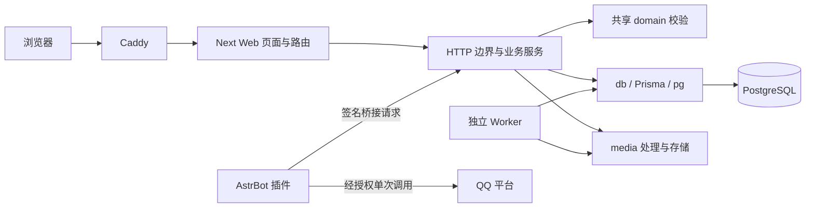

# ArtZoo 架构导览

本文记录仓库中的模块边界、调用入口和不变量，不声明任何环境的实时运行状态。产品目标和历史由既有 Space 维护；实现来源见[来源索引](continuous-development.md)，动态状态只查[唯一 QC 台账](first-release-readiness-progress.md)。本文不替代模块业务契约。

## 模块边界

| 位置 | 职责 | 主要边界 |
| --- | --- | --- |
| [apps/web](../apps/web/package.json) | Next App Router 页面、React/AntD UI、HTTP 和 Web 业务服务 | 服务端鉴权；客户端隐藏按钮不是权限控制 |
| [apps/worker/src/index.ts](../apps/worker/src/index.ts) | 独立维护循环与心跳 | 不依赖有人访问网页；维护会产生业务写入，不能当纯健康探针 |
| [packages/domain/src](../packages/domain/src/index.ts) | 共享 DTO、错误、校验、席位和时间等领域规则 | 供 Web、db、worker 共享，不承担 HTTP 会话或供应商凭据处理 |
| [packages/db/src](../packages/db/src/index.ts) | Prisma/pg 连接、共享事务维护、锁、资格读取和通知存储 | 唯一 schema 及有序 SQL 迁移在该包；部分约束必须查 SQL |
| [packages/media/src](../packages/media/src/index.ts) | 原图/派生处理、格式与存储契约 | Web 服务决定谁可上传/读取；文件可访问性不能取代业务授权 |
| [plugins/astrbot_plugin_artzoo](../plugins/astrbot_plugin_artzoo/README.md) | AstrBot 官方 QQ 确定性桥接 | 复用已有 QQ 客户端；只经签名桥接、受控单次发送与持久回执，不由模型解释报名 |

模块内的 `contract.ts`、`http.ts`、`service.ts` 等名称不是强制每目录同构的框架。新增逻辑先复用现有模块；共享 db/domain 变更需核调用方，不能只验证一个页面。

页面路由组 [(site)](../apps/web/app/(site)/layout.tsx) 目前为首页 `/`、`/resources`、活动列表 `/activities` 和详情 `/activities/[id]` 提供共享 SiteShell；括号目录不改变 URL。其他页面保留各自的布局、页面守卫与业务鉴权，不能从该路由组推断全站已统一布局。

## 请求与后台链路

生产模板 [Caddyfile](../deploy/production/Caddyfile) 终止 HTTPS、限制请求体并反代 `web:3100`；它不是业务鉴权层。Web 只有在实际代理链核验和显式配置满足后才信任来源头，不能从部署拓扑图推断所有 `X-Forwarded-For` 都可信。

以活动为例：[HTTP 边界](../apps/web/server/activities/http.ts) 读取方法、Origin、会话和受限请求体，调用[活动服务](../apps/web/server/activities/service.ts)。服务组合 domain 规则与事务、会话/权限复验，执行 Prisma 或参数化 SQL，原子记录业务和相关站内消息/通知意图，返回 DTO。不同模块有不同体积、锁和通知时机，不能全站替换成一个未经核对的通用写流程。

数据库连接在 [db 入口](../packages/db/src/index.ts) 懒加载并在进程内复用 pg Pool/Prisma；[pool-health.ts](../packages/db/src/pool-health.ts) 统一角色预算与探针。Web/worker 角色的连接预算分开配置，健康检查复用同一个池；它不意味着任意长期事务都可无限运行。

## 认证与授权

[账号契约](account-invitation-contract.md) 和[认证实现说明](../apps/web/server/auth/README.md) 是细节入口。密码及短验证码使用 scrypt；会话与邀请随机 token 只持久化摘要。正式会话 Cookie 使用 Secure、HttpOnly、SameSite 及 `__Host-` 约束，具体环境策略由服务端显式配置决定。

参与身份 `membership`（MEMBER/FRIEND）与管理角色 `adminRole`（普通角色/ADMIN/SUPER_ADMIN）分开，不能从参与身份推导管理权限。[页面守卫](../apps/web/server/auth/page-guards.ts) 负责登录跳转和页面拒绝，服务/API 仍须检查真实会话及职责。账号停用、改密、角色变更及跨锁等待必须遵守模块的事务内复验，不能只相信此前读到的 UI 状态。

写接口按对应模块验证同源、请求头、体积与持久化额度；不是所有端点都使用相同请求体上限。找回密码当前采用统一提示、限流和至少一定等待的同步方案，较慢供应商调用仍可能产生时间差；不声称恒时防枚举。短信未配置失败关闭，配置可用不等于真实送达。错误观测只记录已审白名单字段，不能把原始异常、URL、请求头或内容写日志。

## 公开页面与元数据

[robots](../apps/web/app/robots.ts) 仅允许首页和资源页的精确 HTML 路径及限定的静态渲染依赖；其他页面默认不收录，API 和用户上传图片未因此开放抓取。robots 不是访问控制，禁止抓取也不保证已有搜索结果立即消失。

[公开 OG 入口](../apps/web/server/public-metadata/runtime.ts) 仅对已有游客可读的活动分享和精选照片查询元数据，保持 `noindex/nofollow`。它使用游客身份、固定查询与字段白名单：活动分享取公开标题、简介及首图，精选页采用固定标题、简介及首张已公开入选照片的预览图；不继承会话、管理查询或私有字段。[站点来源校验](../apps/web/server/public-metadata/origin.ts) 只接受显式可信配置，缺失或非法时跳过数据读取并返回通用元数据，不反射 Host、query 或 token；每次请求重新读取可见性，撤回后不保留跨请求内容缓存。外部平台自身的缓存或图片抓取不受此实现保证。

## 数据不变量及其落点

| 不变量 | 实现依据及改动注意 |
| --- | --- |
| 一个活动同一账号只能有一条 ACTIVE 报名 | [活动管理 SQL](../packages/db/prisma/migrations/20261014190000_activity_management/migration.sql) 的部分唯一索引；历史退出记录仍可保留，不能改成覆盖所有历史的普通唯一键 |
| 席位必须属于当前活动/队伍 | [活动初始 SQL](../packages/db/prisma/migrations/20261014120000_single_activities/migration.sql) 与[固定队 SQL](../packages/db/prisma/migrations/20261019010000_fixed_teams/migration.sql) 的复合外键；只验证 seatId 存在不足以防跨对象引用 |
| 计分变更保留来源和前后值 | [ActivityScoreChange](../packages/db/prisma/schema.prisma) 的 eventKey、关联处罚/完成及 sequence；[activity-standing.ts](../packages/db/src/activity-standing.ts) 在账号行锁下更新当前状态并写流水，撤销/更正按原事件重算，不能删旧记录或直接补历史处罚 |
| 已发布抽奖参数和终态结果不可修改 | [抽奖 SQL](../packages/db/prisma/migrations/20261019160000_lottery/migration.sql) 的触发器及状态约束；[维护实现](../packages/db/src/lottery-maintenance.ts) 先提交结果，再幂等构造结果通知，不因通知构造失败重新抽取 |
| 开奖资格来自指定时刻的历史事实 | [资格 SQL](../packages/db/prisma/migrations/20261019163000_lottery_eligibility/migration.sql) 维护历史事实并禁止篡改；[资格读取](../packages/db/src/lottery-eligibility.ts) 和维护逻辑须保留可信时刻、完整性与 opt-out 规则 |
| 外部发送不确定不等于可重发 | [QQ delivery 存储](../packages/db/src/qq-official-notifications.ts) 的租约/fence 与[插件账本](../plugins/astrbot_plugin_artzoo/sender.py) 的持久预留、UNKNOWN/暂停；ACK 重试不能重复调用 QQ |

Prisma [schema.prisma](../packages/db/prisma/schema.prisma) 描述模型，SQL 迁移还包含触发器、部分索引和函数；不能仅用 schema 文本推断完整数据库行为。当前也不是所有日期列都已统一为 timestamptz。新增索引、类型变更、清理或约束必须单独核存量数据及兼容性，不由本文授权。

事务使用 PostgreSQL advisory/行锁与数据库约束共同保护；[ADR-0001](adr/0001-postgresql-coordination.md) 说明现状与代价。锁是业务协议，改键、改共享/独占或改顺序都可能影响其他请求；跨锁后还应重读权限、截止与版本。

## 后台任务与外部边界

Worker 按步骤执行活动维护、抽奖维护、官方活动同步和显式启用的认证临时记录清理，单步失败保留心跳与失败项；本地 QC 安全守卫失败会停止后续工作。停止信号设置停止状态、唤醒等待并释放数据库资源，不能将超时强杀当无损退出证明。

[security-cleanup.ts](../packages/db/src/security-cleanup.ts) 的清理只覆盖明确期限与上限内的认证临时表，由 `ARTZOO_SECURITY_CLEANUP_ENABLED` 显式控制，默认关闭。官方同步同样依赖真实配置。启用后台处理、真实清理、真实短信/QQ、历史补发或处罚都不能由“本地测试通过”推导许可。

QQ 网站侧负责鉴权、绑定、报名事务、签名/时效、队列与最终发送复验；插件负责既有客户端适配、确定性转发、受控发送与本地持久回执。插件 SQLite 账本与 PostgreSQL 业务数据库有不同职责，备份或发布不能用旧账本覆盖当前发送事实。见 [ADR-0003](adr/0003-qq-uncertain-delivery.md)。

## 构建包装与发布边界

[根 Dockerfile](../Dockerfile) 和 [standalone-v2 说明](../deploy/runtime-v2/README.md) 提供 Next standalone Web、独立 Worker、迁移工具及兼容共享镜像的 combined 包装。各角色使用自己的运行闭包；迁移工具保留既有目标守卫，Web/Worker 启动不会自动迁移数据库。Web 启动仍先验证包装及 QC 数据拒绝条件，不能以新包装绕过旧守卫。

既有 [clean-v1 镜像定义](../deploy/images/Dockerfile) 与正式发布链仍是独立协议，旧发布器按包装 label/CMD 拒绝 standalone-v2。生产 Compose 仍共享镜像，独立角色需要单独审核发布配置；本地构建或角色包装通过不等同正式切换。实际运行版本和部署许可查对应发布证据。

## 阅读与维护

贡献流程见[CONTRIBUTING](../CONTRIBUTING.md)，具体启动条件见[开发指南](development.md)，生产操作见[发布流程](release-runtime-workflow.md)和对应版本回执。新架构变化应更新本导览并新增/替代 ADR；已有历史决策不倒写成新用户批准。本文没有新增服务、依赖、端口或自动运行任务。
