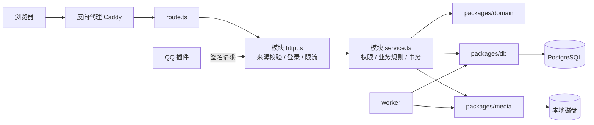

# ArtZoo 架构

本文介绍代码怎么分层、一个请求怎么流转、关键数据规则落在哪里、后台任务做什么，以及有哪些配置开关。业务结构基于代码版本 `fa643541` 整理；第九节的部署架构以当前配置模板和脚本为准，操作步骤见部署手册。

业务规则（例如退出扣几分）不在本文范围内，请看 `rules/`。

---

## 一、模块

| 位置 | 职责 | 依赖 |
|---|---|---|
| `apps/web` | Next.js 页面、全部 API 接口、服务端业务逻辑与鉴权 | domain、db、media |
| `apps/worker` | 独立的后台进程，每 30 秒运行一轮维护任务 | domain、db、media |
| `packages/domain` | 前后端共用的类型、校验、错误码、北京时间等规则 | 无 |
| `packages/db` | Prisma 数据库结构与迁移、数据库连接、各类维护任务、抽奖资格、QQ 投递队列 | domain |
| `packages/media` | 图片解码、去除元数据、本地存储、孤儿图片清理 | domain、db |
| `plugins/astrbot_plugin_artzoo` | QQ 机器人插件（Python），通过带签名的接口和网站通信 | 独立运行 |

### `apps/web` 内部的分层

- `app/api/**/route.ts`：只负责把请求转给对应模块，不写业务逻辑。
- `server/<模块>/http.ts`：校验请求来源、读取请求体、检查登录、限流、把错误转成 HTTP 响应。
- `server/<模块>/service.ts`：业务规则、权限与归属判断、数据库事务。

这是各模块约定俗成的写法，并不是框架强制的结构。新增功能时，参照同一个模块里已有的代码来写。

### 页面路由分组

括号目录不会出现在网址里。

| 位置 | 作用 |
|---|---|
| `app/layout.tsx` | 根布局：AntD 样式注册、全站 Provider；默认不允许搜索引擎收录 |
| `app/(site)/layout.tsx` | 站点外框：背景、公告栏、"跳到正文"链接 |
| `app/(site)/(public)/` | 不需要登录的页面：首页、资源、精选、登录、邀请注册 |
| `app/(site)/(protected)/` | 需要登录的页面：活动、相册、日常、知识库、抽奖、心愿、成员、固定队、个人中心、后台 |
| `app/help-demo` | 使用引导的演示页，不在上面任何分组里 |

`(protected)` 分组的布局只负责读取会话、把会话传给前端，**它本身不会拦截未登录的访问**。真正的拦截靠每个页面自己调用 `server/auth/page-guards.ts` 里的守卫函数：

- `requirePageAccount`：要求已登录。
- `requirePageAdministrator`：要求是管理员。
- `requirePageSuperAdministrator`：要求是超级管理员。

目前这一组下的 50 个页面都调用了守卫。

---

## 二、请求怎么流转



以写操作（POST/PUT/PATCH/DELETE）为例，`http.ts` 会按顺序做以下几件事：

1. **来源校验**：调用 `validateOrigin`（在 `server/auth/http.ts`），以下条件必须全部满足：
   - `Origin` 等于站点配置的地址；
   - 请求头带有 `x-artzoo-request: 1`；
   - `Sec-Fetch-Site` 不是 `cross-site`；
   - `Content-Type` 是 `application/json`。

   上传接口使用各模块自己的同类校验函数。
2. **读取请求体**：每个模块都有大小上限，比如账号模块是 8 KB。
3. **读取会话**：从 Cookie 中取出 token，到数据库查会话，并检查账号是否已被停用。
4. **限流**：来源 IP 由 `resolveRequestSource` 确定。
5. **调用 service**：在 service 里判断权限和归属，然后执行事务。

`/api/health` 是唯一不经过上述流程的接口。

### 登录、会话与权限

- **两套身份互相独立**：参与身份 `membership` 分为正式成员（MEMBER）和朋友（FRIEND）；管理角色 `adminRole` 分为 NONE、ADMIN、SUPER_ADMIN。不能从参与身份推出管理权限。
- **密码**：用 scrypt 哈希保存，比对时用 `timingSafeEqual`。如果手机号不存在，也会拿一个假哈希完整比对一遍，让响应时间和存在时一样。
- **会话**：token 随机生成，数据库里只存它的哈希，有效期 30 天。改密码或重置密码后，该账号的所有会话都会作废。
- **Cookie**：始终带 `HttpOnly` 和 `SameSite=Lax`。
  - 生产环境要求站点地址是 https，Cookie 名为 `__Host-artzoo-session`，并带 `Secure`。
  - 本地开发时只允许 localhost 访问，Cookie 名为 `artzoo-session`。
  - `ARTZOO_DEPLOYMENT_ENV` 只能是 `production` 或 `local`，填其他值时服务直接返回 503。
- **邀请链接**：数据库保存 token 的摘要。如果配置了 `ARTZOO_INVITATION_KEY`，还会额外保存一份 AES-256-GCM 加密的密文，这样管理员之后还能再次查看这条链接。
- **短信**：`ARTZOO_SMS_PROVIDER` 默认是 `unconfigured`，这时发短信的接口返回 503。目前只支持阿里云号码认证服务（`aliyun-pnvs`）。
- **页面守卫与接口鉴权要分开看**：前端把按钮隐藏，不等于有了权限控制。每个接口都必须在服务端自己检查。

### 限流

限流记录保存在数据库表 `AccountRateEvent` 里，按 15 分钟一个窗口计数：

| 桶 | 上限 |
|---|---|
| 同一来源的写操作 | 300 次 |
| 同一账号的写操作 | 60 次 |
| 全站写操作 | 10000 次 |
| 同一手机号 + 同一来源的登录 | 10 次 |
| 同一手机号的登录 | 50 次 |

"来源"由 `server/auth/request-source.ts` 决定：

- 只有在 `ARTZOO_TRUSTED_PROXY=caddy` 时，才读取 `X-Forwarded-For` 的**最后一段**作为来源。IPv4 按单个地址计算，IPv6 按 /64 网段计算。
- 其他情况下，所有人都算作同一个来源 `untrusted-source`，**全站共用一个桶**。

Caddy 部署通过 web 专用 Compose 覆盖文件设置 `ARTZOO_TRUSTED_PROXY=caddy`，并验证代理覆盖 `X-Forwarded-For`；配置关系见第九节。

### 安全响应头

定义在 `apps/web/security-headers.ts`，对所有页面生效：

- `default-src 'self'`
- `script-src 'self' 'unsafe-inline'`（没有使用 nonce）
- `img-src 'self' data: blob:`
- `frame-ancestors 'self'`
- `X-Frame-Options: SAMEORIGIN`
- `Referrer-Policy: no-referrer`
- `X-Content-Type-Options: nosniff`

### 错误与日志

- **业务错误**：抛出 `AccountError`，带错误码、中文提示和 HTTP 状态码。
- **意料之外的错误**：由 `server/http-error-log.ts` 的 `logUnexpectedHttpError` 输出一行 JSON 日志，只记录路由名、错误名和错误码。不记录 message、stack、请求体、手机号或 token。
- **Next 自身的请求错误**：通过 `instrumentation.ts` 也走同一个函数。

---

## 三、数据库

### 连接

- 数据库客户端只能通过 `getDatabase()`（在 `packages/db/src/index.ts`）获取，它在进程内只创建一次。
- 连接池参数在 `packages/db/src/pool-health.ts`：

| 参数 | 值 |
|---|---|
| 连接数上限 | `PG_POOL_MAX`，默认 web 10、worker 3 |
| 获取连接超时 | 3 秒 |
| 单条语句超时 | 15 秒 |
| 等锁超时 | 10 秒 |
| 事务空闲超时 | 30 秒 |
| `application_name` | `artzoo-web` / `artzoo-worker` |
| 会话时区 | 强制 UTC |

- `/api/health` 复用同一个连接池做 3 秒探测，只返回 `{ ok: true/false }`。

### 事务与锁

- **写事务**：统一使用 `ReadCommitted` 隔离级别，`maxWait` 5 秒，`timeout` 15 秒。**只读的列表和快照**多数使用 `RepeatableRead`。
- **锁**：同一对象的并发修改，用 `lock(tx, '类型:id')` 串行处理，底层是 PostgreSQL 的 `pg_advisory_xact_lock`；只读路径用 `lockShared`。这两个函数定义在 `apps/web/server/auth/service.ts`。`packages/db` 里的维护任务各自有一份私有的同名函数，使用同一个哈希命名空间。
- **重试**：`packages/db/src/transaction-retry.ts` 遇到死锁或序列化冲突时会自动重试，但调用方必须显式声明"这个事务可以安全地重放"。目前只有限流使用了它。
- 设计取舍见 [ADR-0001](adr/0001-postgresql-coordination.md)。

### 只写在迁移 SQL 里的规则

有些规则 `schema.prisma` 表达不了，只能写在迁移的 SQL 里。改动下表中的任何一项，都要先找到对应的 SQL 看清楚：

| 规则 | 实现 |
|---|---|
| 每人在同一个活动里，最多只有一条有效报名 | 部分唯一索引 `ActivityRegistration_active_account_key`（`WHERE status='ACTIVE'`）。固定队有同类的 `TeamMembership_active_account_key` |
| 报名的席位必须属于这个活动或这支队伍 | 复合外键 `ActivityRegistration_seatId_activityId_fkey`、`TeamMembership_seatId_teamId_fkey`、`TeamApplication_seatId_teamId_fkey` |
| 积分每次变动都留流水，不重复计分 | 表 `ActivityScoreChange`：`eventKey` 唯一，处罚和完成记录各自唯一，并记录变动前后的值。`packages/db/src/activity-standing.ts` 先锁住账号行，再更新积分 |
| 已发布的抽奖参数和开奖结果不能改 | 触发器 `Lottery_immutable`，加上"已开奖时必须有结果"的 CHECK 约束。函数定义在初始迁移 `20261111000000_init` 里，其中包含"违规删除"这一种允许的变更 |
| 抽奖资格依据开奖那一刻的历史记录 | 表 `LotteryAccountFact` 等，配有一组禁止修改、禁止删除的触发器。详见 [ADR-0002](adr/0002-immutable-lottery-results.md) |

### 规模与约定

- 127 个 model、16 个 enum。旧站的 68 个迁移已在阶段 3 合并为一个初始迁移 `20261111000000_init`；完整结构（含上表这些规则）另记在 `packages/db/prisma/schema-snapshot.txt`，数据库测试会检查两者一致。
- 所有时间字段都是 `timestamptz`。
- 外键默认是 `Restrict`，删除业务数据时，多数情况用"删除标记"代替真正的物理删除。

---

## 四、后台任务（worker）

入口是 `apps/worker/src/index.ts`，每 30 秒运行一轮。每一步单独执行：某一步失败会被记录到 `failedSteps`，下一步照常执行。

| 步骤 | 做什么 | 开关 |
|---|---|---|
| activity | 处罚点数自然减免；缺人的活动到点自动取消；长期活动的首期成团或取消；自动记未到场；活动正常完成后减分 | 始终运行 |
| lottery | 把符合资格的人自动纳入抽奖；到时间开奖；补发没有发出去的结果通知 | 始终运行 |
| officialEvents | 采集官方活动，放进待审核列表 | `ARTZOO_OFFICIAL_SYNC_ENABLED=1`，默认关；采集间隔固定 24 小时 |
| mediaReservations | 清理已经过期的图片上传预留 | `ARTZOO_MEDIA_BUDGET_ENABLED=1`，默认关 |
| mediaOrphans | 删除没有挂到任何内容上的图片 | 预算开关和 `ARTZOO_MEDIA_CLEANUP_EXECUTE=1` 都打开才运行，默认关 |
| cleanup | 每天一次：删除 1 天前的限流记录，以及过期或作废超过 7 天的会话和验证码 | `ARTZOO_SECURITY_CLEANUP_ENABLED=1`，默认关 |

- **停止**：收到 SIGINT 或 SIGTERM 后，worker 会先等当前这一轮跑完，再断开数据库连接，然后退出。
- **运行参数**：`--once` 只运行一轮；`--require-db` 表示没有配置数据库时直接报错退出。
- **QQ 消息不由 worker 发送**：由 QQ 插件主动来网站领取，见第六节。

---

## 五、图片与文件

- **存储位置**：只用服务器本地磁盘，见 `DECISIONS.md` 第 2 条。
  - 生产环境默认写到 `/app/storage/original/<类别>`（原图）和 `/app/storage/derived/<类别>`（缩略图、预览图）。每个类别都可以用 `ARTZOO_<类别>_ORIGINAL_DIR` / `_DERIVED_DIR` 单独指定。
  - 头像目录用 `ARTZOO_AVATAR_DIR` 指定，必须是绝对路径。**生产环境一定要设置它**，否则会退回到仓库下的 `.local/avatars`。
- **删除后的文件**：相册照片被删除（单张、批量或整个相册）后，原图、预览图、缩略图三个文件也会被删掉，仍是其他相册封面的照片除外。开着上传配额时先核对文件是不是当初上传的那个再删，并把容量还给配额；配额关着时按照片 ID 直接删。删除失败的照片可以在相册里查看进度并重试（`albums/service.ts`、`packages/media/src/stock-retirement.ts`）。
- **上传并发**：`withUploadSlot` 控制同时上传的请求数，用 `ARTZOO_UPLOAD_CONCURRENCY` 设置，范围 1–8，默认 2，超过时返回 503。`withPhotoSlot` 控制同时进行的图片解码，固定为 2。
- **校验与处理**：
  - 按文件头判断格式，不接受 SVG。
  - sharp 处理时设置了像素上限和超时。
  - 单张照片最大 30 MB，头像最大 10 MB。
- **去除元数据**：原图保存前，用 `packages/media/src/metadata-strip.ts` 去掉 EXIF、GPS 等信息，只保留图片方向。
- **读取**：每次读取图片都要先经过业务权限检查。私有图片的响应头是 `Cache-Control: no-store`。
- **上传配额**：开启 `ARTZOO_MEDIA_BUDGET_ENABLED` 后才生效，默认全站总量 10 GB，每天 2 GB（按北京时间计算日期）。

---

## 六、QQ 机器人

- **网站这一侧**（`server/qq-official`、`server/bot-management`、`packages/db/src/qq-official-notifications.ts`）负责：账号绑定、在群里报名时的事务处理、通知排队、签名校验。
- **插件这一侧**（`plugins/astrbot_plugin_artzoo`）定时向网站领取待发送的消息，调用 QQ 发送，然后把结果回报给网站。
- **防止重复发送**：
  - 领取消息时有 30 秒租约和版本号（fence）。
  - 插件在本地 SQLite 账本里记录每一次发送。
  - 如果发送结果不确定，标记为 UNKNOWN，**不会自动重发**。

  详见 [ADR-0003](adr/0003-qq-uncertain-delivery.md)。
- **通信安全**：所有请求都使用 HMAC-SHA256 签名，并带时间窗口和 nonce 去重。密钥是 `ARTZOO_QQ_BRIDGE_SECRET`。
- **默认关闭**：`ARTZOO_QQ_MODE` 默认未设置。真实发送需要同时满足多项配置，见第八节。

---

## 七、公开页面与搜索引擎

- **robots**（`app/robots.ts`）：只允许搜索引擎收录首页和资源页，以及它们需要用到的静态资源，其他页面一律禁止收录。注意 robots 只是告诉搜索引擎别收录，并不是访问控制。
- **分享卡片（OG）信息**：`server/public-metadata` 只为游客本来就能看到的精选照片生成。它以游客身份读取数据，不带任何会话；读取失败时，返回不允许收录的通用信息。站点地址只读 `ARTZOO_PUBLIC_ORIGIN`。

---

## 八、配置开关一览

家庭站的 web 已配置 `ARTZOO_SMS_PROVIDER=aliyun-pnvs`，注册和重置密码模板编号分别为 `100001`、`100003`。下表“默认”列表示未配置时的值。

| 变量 | 默认 | 说明 |
|---|---|---|
| `ARTZOO_DEPLOYMENT_ENV` | 无 | 只能是 `production` 或 `local` |
| `ARTZOO_PUBLIC_ORIGIN` | 无 | 站点地址，生产环境必须是 https |
| `ARTZOO_TRUSTED_PROXY` | 空 | Caddy 部署通过 web 专用 Compose 覆盖文件设为 `caddy` |
| `ARTZOO_INVITATION_KEY` | 无 | 独立随机 32 字节的规范 Base64 编码（44 字符）；缺失或格式错误时无法生成邀请链接 |
| `ARTZOO_SMS_PROVIDER` | `unconfigured` | web 设为 `aliyun-pnvs` 并完整配置下列字段才启用；worker、tools 固定关闭 |
| `ARTZOO_SMS_ACCESS_KEY_ID` / `ARTZOO_SMS_ACCESS_KEY_SECRET` | 空 | 阿里云短信凭证，仅传给 web，作为秘密处理 |
| `ARTZOO_SMS_SIGN_NAME` | 空 | 短信签名；开启短信时必填 |
| `ARTZOO_SMS_REGISTER_TEMPLATE_CODE` / `ARTZOO_SMS_RESET_TEMPLATE_CODE` | 空 | 开启短信时分别必须是 `100001` / `100003` |
| `AUTH_SMS_DAILY_LIMIT` | 200 | 全站每日短信预约上限，北京时间自然日，整数 1–10000；失败发送和虚拟预约也占额 |
| `ARTZOO_MEDIA_GLOBAL_LIMIT_BYTES` / `ARTZOO_MEDIA_DAILY_LIMIT_BYTES` | 10000000000 / 2000000000 | 正整数字节数，不超过有符号 64 位整数上限；每日不得超过全站 |
| `ARTZOO_AVATAR_DIR` | 仓库下的 `.local/avatars` | 生产环境必须设置为绝对路径 |
| `ARTZOO_UPLOAD_CONCURRENCY` | 2 | 同时上传的请求数，范围 1–8 |
| `ARTZOO_MEDIA_BUDGET_ENABLED` | 关 | 上传配额 |
| `ARTZOO_MEDIA_CLEANUP_EXECUTE` | 关 | 真正删除孤儿图片 |
| `ARTZOO_SECURITY_CLEANUP_ENABLED` | 关 | 每天清理过期的认证记录 |
| `ARTZOO_OFFICIAL_SYNC_ENABLED` | 关 | 自动采集官方活动 |
| `ARTZOO_QQ_MODE` | 未设置，即关闭 | `simulation`（只能在本地使用）或 `live`。`live` 模式还需要真实发送开关、测试群确认、APP_ID / BOT_ID / 群 openid、启用时间等多项配置，详见 `packages/db/src/qq-official-config.ts` |
| `ARTZOO_QQ_BRIDGE_SECRET` | 无 | 网站和插件之间通信用的签名密钥 |
| `PG_POOL_MAX` | web 10 / worker 3 | 数据库连接数上限 |

本表列通用默认值；部署配置关系见第九节，实际配置步骤见[部署配置操作手册](DEPLOYMENT.md)。

---

## 九、部署镜像与交付

部署决定见 [DECISIONS.md](DECISIONS.md) 第 8–16 条。安装、配置、发版、备份、恢复和验收步骤见[部署操作手册](DEPLOYMENT.md)。

### 运行布局

- **Dev**：保留源码并构建镜像，Docker 使用 rootless 与独立网络，避免覆盖 Server 的防火墙规则。Docker 下载代理通过用户服务配置；构建步骤使用 `ARTZOO_BUILD_PROXY`，代理不写入运行镜像环境。家庭代理配置允许 Dev 容器访问宿主回环服务。
- **Server**：安装 Caddy、Docker 和 Docker Compose，接收版本化发布包，不拉取源码，也不需要宿主 Node、pnpm 或 Python。web、worker、PostgreSQL 由 Compose 管理；tools 只用于显式维护。
- **Windows**：WSL 使用 mirrored、DNS 隧道、自动代理及本机 IP 回环；宿主防火墙将家庭入口限定为指定局域网到 TCP 443。Windows 不安装 Caddy，不配置家庭公网端口映射。
- **正式服务器**：沿用镜像发布方式；独立 Linux 服务器不需要 WSL 配置，域名入口使用单独的 Caddy 模板。

Windows 固定入口 `artzoo-resident.ps1` 按 `deploy/current` 选择并校验当前发布包。`-start` 先启动隐藏的 WSL 常驻进程，再启动已有的 PostgreSQL、web、worker 和 Caddy。关闭终端后网站可以继续运行，Windows 重启后由站长重新执行 `-start`。`-status` 分别检查常驻、应用版本与健康状态，以及 Caddy 服务。发行版已关闭时，查询会直接返回关闭状态。

### HTTPS 与代理

访问链路为固定局域网地址的 HTTPS → Server Caddy → `127.0.0.1:13100` → web 容器 `3100`。worker 不发布端口；PostgreSQL 只接内部网络、不发布宿主端口；Caddy 管理接口仅监听回环地址。

家庭入口使用 Caddy 内部 CA，当前允许设备证书警告，设备信任状态单独记录。正式域名模板使用自动 HTTPS；证书和私钥保存在 Server，不进入仓库或发布包。

Caddy 覆盖转发头；应用仅在 `ARTZOO_TRUSTED_PROXY=caddy` 时信任来源。基础环境配置保持该值为空，由 `/srv/artzoo/deploy/proxy.compose.yaml` 仅为 web 启用。维护脚本自动加载并校验覆盖文件，拒绝额外服务、字段或不可信文件。

### 镜像与发布包

| 镜像 | 内容与用途 |
|---|---|
| web | Next standalone、静态资源、独立 BMP 线程及生产依赖 |
| worker | 编译后的后台程序及生产依赖，默认要求数据库配置 |
| tools | Prisma CLI、迁移、媒体基线、媒体身份重新登记和受保护的超管初始化入口，默认只显示说明 |

应用镜像统一使用锁文件和固定 Node 基础镜像，默认以 UID/GID 1000 运行。`.dockerignore` 排除宿主依赖、私有配置、密钥和运行数据；Compose 仅引用镜像，不挂源码、不执行构建。

| 发布包内容 | 文件或用途 |
|---|---|
| 镜像与清单 | `images.tar`、`images.tsv`、`source.txt`、`SHA256SUMS` |
| 运行配置 | `compose.yaml`、`.env.example`、`runtime-config.manifest`、由镜像清单生成的 `images.env` |
| 构建与验收工具 | `deployment-images.sh`、`deployment-image-check.mjs`、`deployment-compose-check.sh`、`deployment-https-check.mjs` |
| 维护入口 | `deployment-maintenance.sh` |
| 备份与恢复 | `deployment-backup.sh`、`artzoo-backup-launcher.sh`、`artzoo-backup.service.example`、`artzoo-backup.timer.example` |
| 升级与回退 | `deployment-upgrade.sh` |
| 家庭站常驻 | `artzoo-resident.ps1`、`deployment-resident.sh` |
| 媒体身份 | `deployment-media-identity.mjs`、`deployment-media-reregister.sh` |
| 配置模板 | 七份 Caddy、代理覆盖、WSL 网络及 Dev Docker 配置模板，源文件位于 `deployment/` |
| 操作手册 | `DEPLOYMENT.md` |

发布包输出到仓库外的独立版本目录，交付文件逐项纳入 SHA-256 校验；导入还核对镜像 ID 和平台，不替换同名不同内容的镜像。校验和用于完整性检查，发布包仍须来自可信开发端。PostgreSQL 官方镜像单独准备，不包含在三个应用镜像中。

正式候选包来自干净工作区；允许未提交改动或仅构建部分镜像时使用 `dev-` 标签。完整 Compose 和维护流程需要三个镜像；发布包导入不切换正在运行的网站。

### 运行配置清单

`deployment/runtime-config.manifest` 随发布包交付并参与 SHA-256 校验。每行用 `|` 分隔变量名、必填条件、秘密标记、校验规则、默认值、目标服务；`fixed` 行描述不可由环境文件覆盖的容器策略，`-` 表示仅供宿主使用。新增常规运行变量只需修改清单与 `compose.yaml`，不再修改维护脚本的变量白名单。

环境文件只接受清单声明的输入变量。可选项未提供或为空时使用清单与 Compose 中一致的默认值；短信的五个字段在 `aliyun-pnvs` 下全部必填，关闭时必须为空。普通值使用 `NAME=value`；含 `$`、`#`、引号或反斜杠时使用单引号包裹，内部单引号写作 `\'`。不接受末尾反斜杠、反斜杠紧邻单引号的值、双引号插值、多行值、行尾注释或首尾空白；不会执行文件内容。

只读命令 `bash "$bundle/deployment-maintenance.sh" config-check --bundle "$bundle" --root "$root"` 校验发布包及配置，汇总缺失、多余和格式不符的变量名，不显示值，不连接 Docker、不创建锁或临时文件。它不代表镜像已导入、代理已验收或短信已发送成功。实际维护仍核对镜像 ID、挂载和代理覆盖；`check_app` 按清单比较所有声明的非秘密容器变量，秘密仅在读取配置时校验格式。

web、worker 使用 `json-file` 容器日志，每个文件最多 `10m`，最多保留 `3` 个；维护检查会核对实际日志设置。tools 使用 `none`，不持久记录初始化交互。语法依据 [Docker 日志配置](https://docs.docker.com/reference/compose-file/services/#logging)及[环境文件插值规则](https://docs.docker.com/compose/how-tos/environment-variables/variable-interpolation/)。

### 持久化与维护

| 数据或配置 | Server 位置 | 约束 |
|---|---|---|
| PostgreSQL 数据 | `artzoo_postgres-data` named volume | 固定 Compose 项目名，重建容器保留数据卷 |
| 原图、衍生图、头像 | `/srv/artzoo/media/{original,derived,avatars}` | UID/GID 1000、目录 0700；web、worker、tools 共用 |
| 秘密配置 | `/srv/artzoo/secrets/compose.env` | 文件 0600、secrets 目录 0700，不随包传输 |
| 代理覆盖 | `/srv/artzoo/deploy/proxy.compose.yaml` | 仅覆盖 web 的代理信任配置，文件及上级目录不可被组或其他用户写入 |
| Caddy 配置与状态 | `/etc/caddy/Caddyfile`、`/var/lib/caddy/` | 配置、证书和私钥留在 Server；模板单独入库 |
| 发布包 | `/srv/artzoo/releases/<版本>` | 保留旧版本，不原地修改已校验的包 |
| 部署状态 | `/srv/artzoo/deploy/` | `current` 记录当前发布包、版本和配置清单来源，`previous` 记录一级回退所需的旧包及备份 |
| 备份 | 默认 `/srv/artzoo/backups/` | 一份备份包含 PostgreSQL 导出、迁移列表、原图/衍生图/头像归档和校验清单 |

媒体使用 Linux 文件系统；目录及祖先须属于 root 或运行用户，不能被组或其他用户写入。Compose 拒绝缺失的挂载目录，不自动创建或放宽权限。

迁移、媒体基线和首位超管初始化均为显式维护，不随网站启动执行。配额须在基线完成后启用；worker 开启认证记录清理，孤儿媒体删除、官方采集和 QQ 固定关闭；短信默认关闭，仅 web 可按清单启用。维护入口核对发布包、镜像及运行配置；日常启停保留数据，不执行初始化或升级。

### 备份、升级与回退

- **【危险】备份会短暂停站。** 手动和定时备份都先停止 web、worker，校验数据库导出和媒体归档，恢复应用并检查健康后才发布新备份。定时入口按 `deploy/current` 找版本，维护未完成时拒绝备份，最近一次结果记在 `deploy/backup-last`。启用随包的 systemd 定时器后，按北京时间每天 03:00 运行，Server 关闭时错过的那次不会补跑。
- **【危险】升级会停站并执行迁移。** 维护脚本核对发布包及镜像、当前容器和迁移记录，停写后先生成并校验升级前备份，再执行向前迁移、重建应用并检查健康。新版本通过健康检查后才更新 `current`。迁移开始后失败时保留备份和待处理标记，保持停站以便处理。
- **【危险】回退会丢弃升级后写入的数据。** 使用本次新包的维护入口，先核对旧包具备媒体登记能力并另存当前状态，再还原升级前的数据库和媒体、重建旧版容器。回退只支持一级，数据库随备份恢复。此时 `current` 已指向旧版，web、worker 继续停止，开站条件见第十节。

日常备份默认保留 7 份，升级前、救援和登记前备份每类默认保留 3 份。备份或维护成功后才清理已校验的同项目、同 PostgreSQL 镜像备份，并保护回退引用、每类最新及本次备份。完整操作与失败处理见[部署操作手册](DEPLOYMENT.md)第 1、2 节。

### 验证与边界

- 镜像和 Compose 检查使用独立临时资源，覆盖运行依赖、空库迁移、媒体基线、worker、挂载和持久化；不连接家庭数据库。
- HTTPS 检查核对证书、健康接口和伪造转发头，结束后恢复临时修改的 Caddy 配置；多设备访问与入口隔离按部署手册验收。
- 配置检查、容器健康和 HTTPS 访问分别记录。登录、上传、权限和备份恢复按各自的实际操作验收，任务状态见 [PLAN.md](PLAN.md)。

---

## 十、媒体身份重新登记：设计与维护边界

设计比较以包含只读 `media-identity` 的代码 `456ba25` 为依据；站长已在任务对话中同意采用方案 1，当前实现为显式离线登记。方案 2 保留作比较，未实现。新命令仅随包含本功能的新发布包交付，旧包不支持。具体实测证据留在本机或 PR，不写入本架构说明。

### 问题、边界与建议

数据库把文件和媒体目录的物理身份长期保存为哈希。备份解包重建文件，或挂载后设备编号变化，即使内容未变也可能导致身份比较失败。诊断只有哈希和计数时，不能反推究竟是设备号、inode、属主还是路径发生变化；启动顺序相关的实测支持挂载身份变化这一推断，但不能代替原始 `stat` 对照。

本轮采用**方案 1：显式停写、按原内容证明重新登记**。它保留日常删除的物理身份约束，符合本轮“不降低现有安全保证”的要求；代价是每次恢复或身份发生变化后都要再维护一次。方案 2 可免去单纯设备号/inode 变化后的登记，但改变了“同一文件”的含义，需要单独批准安全取舍和迁移方式。

“全部更新”指当前仍需占用磁盘、具有可靠内容证明的组件及当前基线，不包括已经完成删除并返还配额的历史记录。缺失证明、未知类型和无法核实的聚合记录必须整体拒绝，不能用跳过计数伪装成登记成功。不得重建空基线、清零配额、采用磁盘现算哈希覆盖数据库原哈希，或在启动时静默修复。

### 原算法防护的对象

`stock-bound-io.ts` 的目录身份为末级目录的 `[dev, ino, uid]`；所有祖先仍逐个检查类型、属主、写权限和真实路径，但镜像内祖先 inode 不进入长期哈希。`rootHash` 还包含媒体类别和规范化绝对根路径；文件物理指纹包含 `rootHash`、对象 UUID、部件名、文件 `dev/ino/uid` 和原内容哈希；最终数据库指纹再绑定上传 `generation`。

这可以发现同名文件或整个媒体子目录被换成另一个物理对象，包括内容恰好相同的副本；配合 `generation` 防止跨上传批次套用证明。它不等于内容校验：内容被原地改写时仍需 SHA-256、长度和读取前后状态检查。`dev/ino` 是文件系统设备及 inode 编号，不是跨恢复稳定的业务标识，见 [Node 24.21 文件状态定义](https://nodejs.org/download/release/v24.21.0/docs/api/fs.html#statsdev)。

两种方案都必须保留：服务端 UUID 路径、可信目录及祖先、拒绝符号链接/硬链接/特殊文件、文件属主及权限、受限读取、内容与计费字节校验、操作内的根目录和文件身份复核、真实删除证明、目录同步，以及配额返还幂等。删除前后的 `lstat/unlink` 不是原子的“比较后删除”；现有保证依赖私有目录、停写或受控写者和 UUID 不复用，不能声称防住有 root 或同 UID 任意写权限的恶意并发者。

### 两种方案比较

| 比较项 | 方案 1：离线重新登记 | 方案 2：长期逻辑身份，操作内物理身份 |
|---|---|---|
| 长期身份 | 保持现有公式；维护时更新当前可信文件的物理身份 | 新公式只绑定稳定命名空间、根路径、文件名、原内容哈希及 `generation` |
| 同内容文件/目录替换 | 日常拒绝；仅显式维护且全部核验通过后接受新物理对象 | 替换发生在两次操作之间时接受，这是有意降低跨操作物理连续性要求 |
| 内容篡改、越界及链接 | 沿用原检查并整体拒绝 | 同样拒绝；不能因为逻辑哈希相同就跳过实际内容和路径检查 |
| 一次删除内发生替换 | 保留打开时、删除前后物理比较 | 保留；必须另存内存中的物理 `rootHash`，不能把它一起改成逻辑哈希 |
| 恢复/启动顺序变化 | 发现不一致后再次停写登记 | 完成一次转换后，内容、根路径和属主策略未变即可继续使用 |
| 数据库迁移 | 下述受限方案无结构迁移；显式维护事务重登记 | 建议新增状态与组件的算法版本列；不能根据同样长的 64 位哈希猜版本 |
| 历史删除凭据 | 完成链原样保留；未完成删除存在冲突则拒绝 | 完成链保持旧版本；活动组件转换，未完成删除仍需专门处理 |
| 规模估算 | 产品代码约 250–400 行；脚本及测试约 450–600 行 | 产品代码约 500–900 行；脚本及测试约 700–1000 行，预计超过本轮上限 |

规模为设计估算，不是已经验证的承诺。实现前复核，脚本及测试若超过约 600 行必须停下报告；不得通过少测失败路径压缩规模。方案 1 也只在授权维护期间以原内容证明重新建立信任，不保证识别维护前已经替换的同内容副本。

### 方案 1：维护流程与事务边界

维护入口为 `media-reregister`，属于【危险：停写并更新身份】。以现有发布包、镜像、配置和 `deploy/current` 校验为前置，沿用维护互斥锁；已有升级/恢复 `pending` 时拒绝，不能绕过任务 F 的失败保护。

1. 站长安排停写；停止 web、worker 并确认它们退出，禁止其他 tools、宿主脚本和人工写媒体。维护锁只能协调本工具，不能阻止任意外部写者。数据库保持运行；工具使用应用相同 UID 和容器内路径，媒体只读挂载。
2. 停写后使用现有 `create_snapshot` / `publish_snapshot` 内部原语另存并校验维护前备份；不能调用会自行重启应用的普通 `backup` 入口。备份失败不得进入登记，也不清理现有备份。开始停写后，备份或后续任何阶段失败均保持停站，不自动恢复写入。
3. 开启一个数据库事务，核对目标库、全局基线和账目。沿用 `packages/db/src/media-baseline.ts` 已列出的媒体/业务表锁清单及 `NOWAIT` 思路，不调用只允许空库的断言；并锁住全局状态。存在并发写事务时直接拒绝。`ReadCommitted` 本身不提供整个流程的稳定快照，必须依赖停写与锁，见 [PostgreSQL 17 隔离说明](https://www.postgresql.org/docs/17/transaction-iso.html#XACT-READ-COMMITTED)。
4. 按主键分页枚举完整组件集合并核对 receipt、对象、generation、部件完整性、计费总额、intent 与 credit。只支持已初始化且 `baselineBytes=0`、没有 BASELINE 来源聚合组件的现行空站基线；不以文件扫描重建旧聚合账。数据库 bytea 图标不参与磁盘身份更新，仍保留账目关系；未绑定、未知或非零不透明磁盘聚合项导致整体拒绝。
5. 对所有未返还配额的磁盘组件，使用原 `contentBindingSha256`、原 `chargedBytes` 和可信映射调用 `BoundNamespace.inspect`。普通图片要求完整内容哈希及长度一致；知识库 journal 沿用“prepared 首行哈希 + 合法后续状态行 + 计费上界”的既有协议，不能误当成整文件 SHA-256。任何缺失、链接、不可信权限、内容错误或读取变化都整体拒绝。
6. 对已完成的 `ACKNOWLEDGED + credit` 链先验证账目关系，再整体保留组件、intent、credit 的历史身份；不要求被正确删除的文件重新出现，不重复返还。任何没有 credit 的现存删除意图（包括 PREPARED），或 ACK/credit 状态矛盾，均整体拒绝。不能只改组件让 intent 悬空，也不能凭 `ENOENT` 伪造删除成功。
7. 全量核验完成后，在同一事务内重算并更新所有当前磁盘组件的 `storageIdentityFingerprint` 及 `MediaBudgetState.baselineFingerprint`。更新时带原指纹、generation、内容绑定条件并检查影响行数；不改金额、receipt、创建时间、基线初始化时间、业务删除状态和原内容哈希。保持公式与原算法完全一致，重复执行仅报告无变化。
8. 提交前再次检查目录与每个候选文件的物理身份、内容和集合一致性；任一变化使数据库整体回滚。按页打开、及时关闭句柄：每页 128 行，最多 10000 个组件、10 GB 当前磁盘计费字节、240 秒事务；超过上限报错而非分批提交。事务内两轮全量读取会延长停站；当前限额是保护上限，不代表 10 GB 一定能在时限内处理完，实际吞吐须按站点硬盘验证。
9. 提交后在继续停写的状态执行独立 `media-identity`，必须所有应检查项一致且 `unchecked=0` 才按原运行状态启动并检查健康。失败保留备份和停站状态，报告明确错误码与数量，不打印秘密、文件内容或完整数据库记录。

数据库事务只能回滚数据库；磁盘是只读的，没有“跨 PostgreSQL 与文件系统的原子事务”。提交前失败保留旧身份；进程被杀、连接中断或提交响应不确定时，保持停站并重新只读检查，不能自动启动或猜测提交结果。提交后检查失败也不得自动恢复数据库。旧备份恢复会再次改变文件身份，恢复后仍需登记，不能把“恢复备份”描述成身份问题的直接解药。

**受限点必须在实施前认可：** 若站长已经尝试删图而留下 PREPARED，或文件已消失但返还尚未确认，本提案会安全拒绝，不能直接修好该现场。应先只读判断是否存在此状态；确有此情况时，补充“取消/承接未完成意图且保留审计”的设计并重新评估迁移与规模，不删记录绕过，也不自动恢复覆盖用户数据。本轮只读诊断未提供 intent/credit 详情，不能假定现场没有这类记录。

### 方案 2：算法及迁移边界

建议以带域标记的规范编码计算 `H(["media-logical-v2", kind, root, UUID, part, expectedHash])`，再绑定 `generation`。长期基线改为带版本标记的固定三根路径指纹；每次仍检查所有祖先、目录属主和权限。真实路径改变仍需维护；如果希望任意搬目录也无需转换，那是另一种方案，不在本提案内。

`BoundNamespace` 必须分离长期逻辑指纹与 `Held` 中的物理根身份、文件句柄及 dev/ino，`capture/remove` 继续复核后者。删除授权、内容证明、回收幂等和各媒体类别的真实 IO 路径都须回归，不能只改 `physicalFingerprint` 一行。同内容目录树换盘后会被接受；如果业务要求连这种替换也要拒绝，应选方案 1。

建议新增显式版本字段（默认旧版），由新迁移增加列与约束；完成删除的历史组件保持旧版，只有全部核验通过的当前组件及基线在一个维护事务里转换到新版。不能从旧 SHA-256 反算路径/dev/ino，SQL 也无法代替应用读取容器挂载文件。此次转换必须解释为显式文件校验维护，而不是应用启动时数据回填；若被要求“所有转换只能写在迁移 SQL 中”，它与此方案冲突，须先批准例外或另设计，不能暗中绕过 `packages/db/AGENTS.md`。

初次转换仍需方案 1 的停写、备份、全量验证和未完成删除处理；转换失败保留旧版并停站。旧程序不识别新版时不得启动；回退使用旧镜像和升级前备份，并处理该备份恢复后的物理身份，不尝试反算旧哈希。新增迁移须按仓库要求在空库跑通、检查 diff 并更新结构快照。现阶段不建议为省去维护命令承担这组额外变化。

### 目录身份与派生引用的完整索引

以下为本次实际全文检索后归纳的生产位置；行号对应本节依据版本，后续以符号检索为准。执行证据和原始匹配输出不入仓库。检查范围包含 `packages`、`apps`、`scripts` 及 schema/迁移，不能只搜字段定义：

```bash
rg -n 'baselineFingerprint|storageIdentityFingerprint|identityFingerprint|evidenceFingerprint|trustedMediaDirectoryIdentity|rootIdentity|rootHash|physicalFingerprint|namespaceIdentity' packages apps scripts
rg -n '\.dev\b|\.ino\b|mtimeNs|ctimeNs' packages/media apps/web/server scripts
```

| 保存位置或派生位置 | 写入、使用位置与含义 |
|---|---|
| `MediaBudgetState.baselineFingerprint`（schema:1955） | `packages/media/src/media-baseline.ts:25–32` 生成三根路径及物理身份的整体哈希；`packages/db/src/media-budget.ts:193–199` 写入/幂等比较；`packages/db/src/media-baseline.ts` 锁定维护目标 |
| `MediaStoredComponent.storageIdentityFingerprint`（schema:2011） | `packages/media/src/stock-bound-io.ts:70–110,254–278` 生成目录及文件身份；`stock-retirement.ts:271,357–362` 绑定 generation 后写入，后续删除全链路比较 |
| `MediaStoredComponent.baselineFingerprint`（schema:2002）及聚合 `id/objectKey/generation` | `packages/db/src/media-stock-components.ts:251–258` 将基线哈希复制或派生进四个字段；现行空基线 bytes=0 不建该行，但非空基线不能漏掉它们 |
| `MediaRetirementIntent.identityFingerprint` 及 `id`（schema:2019–2022） | `stock-retirement.ts` 的 prepare 路径、db 各 retirement/orphan 模块复制组件身份，并把它加入意图 ID；并非独立目录字段，却必须纳入更新影响分析 |
| `MediaStorageCredit.evidenceFingerprint` 及 `intentId`（schema:2033–2036） | `stock-retirement.ts` 以真实 unlink 证明派生；`packages/db/src/media-orphan-completion.ts` 重验 identity、intent ID 和 evidence；历史链不得随登记改写 |
| 内存中的物理身份及证明 | `stock-bound-io.ts` 的 `Held.rootHash/dev/ino`、私有 `held/written/removed`；`media-baseline.ts:36–59` 的空目录扫描快照；`stock-retirement.ts` 的授权/删除证明及候选描述；不会跨进程持久化 |
| 独立的操作内文件身份 | `apps/web/server/knowledge/image-upload-receipts.ts:91,122,134–135` 用 dev/ino 守卫 journal 清理；不是长期目录身份，不应一并删除其比较 |
| 诊断和发布检查 | `scripts/deployment-media-identity.mjs` 重算基线及文件指纹；`scripts/deployment-maintenance.sh` 导出身份快照并校验基线形状；`scripts/deployment-image-check.mjs` 写测试基线值，不是正式登记器 |
| 数据定义的其他副本 | `packages/db/prisma/migrations/20261111000000_init/migration.sql` 与 `packages/db/prisma/schema-snapshot.txt` 中的表、CHECK、外键及引用；旧迁移不可改 |

除上表的生产写入点，以下消费者也全部命中身份字段，审查不能遗漏（路径均相对仓库）：

- `packages/db/src/official-media-retirement.ts`、`official-media-contract.ts`（后者同属该目录）。
- `packages/db/src/media-orphan-maintenance.ts`、`media-wish-orphan.ts`、`media-lottery-orphan.ts`、`media-knowledge-orphan.ts`、`media-album-comment-orphan.ts`。
- `packages/db/src/media-orphan-contract.ts`、`media-wish-orphan-contract.ts`、`media-lottery-orphan-contract.ts`、`media-knowledge-orphan-contract.ts`、`media-album-comment-orphan-contract.ts`。
- `packages/db/src/media-photo-orphan-checks.ts`、`media-lottery-mount.ts`、`media-quick-icon-stock.ts`；`apps/web/server/albums/service.ts:790,852` 的删除状态查询。

实际目录映射还须覆盖 `original/derived` 下的 `daily`、`wishes`、`lotteries`、`knowledge`、`albums`、`official-events`，以及 `avatars`；knowledge journal 共用 `original/knowledge`，相册照片与评论共用 `albums`，官方类别在数据库为 `official-image`、IO 为 `official`。不能只处理这次照片涉及的三个组件。

### 实施范围与验收

实现涉及 `packages/media` 的校验/登记入口、`packages/db` 的锁定与账目核对、维护脚本、发布包清单、tools 镜像及行为测试；唯一改动文档为本文件。原有身份算法不变，没有数据库结构迁移，也不修改旧发布包。

当前脚本执行原地恢复或回退后，web、worker 保持停止，并留下 `deploy/media-registration.pending`。标记存在时，普通 `start`、升级和回退均被拒绝。此时可执行只读诊断、停站、重试登记，或带 `--keep-stopped true` 的恢复。登记完成、独立诊断及必要的健康检查通过后才移除标记。失败时保留备份和标记，由站长核对现场。旧包的恢复和回退能力见[部署操作手册](DEPLOYMENT.md)中的版本说明。

Server 由站长在当前发布包变量 `bundle`、站点变量 `root` 已正确设置后单独执行：

```bash
# 【危险：覆盖当前站点】恢复后保持停写，备份版本必须匹配
bash "$bundle/deployment-maintenance.sh" restore --bundle "$bundle" --root "$root" --backup "$snapshot" --keep-stopped true
```

```bash
# 【危险：停写、备份并登记】也用于重启后发现不一致的现场
bash "$bundle/deployment-maintenance.sh" media-reregister --bundle "$bundle" --root "$root"
```

开站前先完成独立的 `media-identity` 检查，基线和文件组件的 `inconsistent`、`unchecked` 都须为 0。登记脚本在停写状态下执行这项检查，之后按记录的运行状态处理。

- 回退记录为 `running`。看到 `PASS: rollback` 时仍处于停站状态。站长按脚本输出执行【危险】`media-reregister`，通过后自动启动旧版并检查健康。
- 原地恢复在覆盖前另存现场。登记成功后默认回到恢复前的运行状态。若恢复前已停站，或恢复时显式指定 `--keep-stopped true`，登记成功后仍保持停止，由站长按[部署操作手册](DEPLOYMENT.md)单独启动。
- 开站后查看 `status`，通过 HTTPS 登录并查看恢复前上传的图片。用已恢复的测试图片验证删除和配额退回，重试删除时配额只退回一次。

登记前检查备份空间，停写后先生成并校验 `register-*` 备份。登记或独立诊断失败时保持停站。自动启动后健康检查失败时，脚本尝试停止应用并保留标记。运行中的遗留 tools 容器会使重试被拒绝，由站长核对本次维护容器。

实现验收包括下列场景；实际结果与尚待家庭 Server 完成的项目以实现 PR 为准：

- Dev rootless Docker 一次性项目：已存在的图片及各类路径 → 真实备份恢复 → 登记 → 诊断全部一致 → 通过正式删除路径删旧照片，三组件文件消失，配额恰好退回一次，再次重试不重复退回。
- 原始/缩略/预览、头像、journal、官方及各照片 namespace 均覆盖；已返还历史项保持原样，bytea 不误计为磁盘文件。聚合、不支持类型、缺失绑定和 PREPARED/矛盾账目必须整体拒绝。
- 同长度不同内容、缺文件、符号链接、硬链接、不可信目录、扫描期间替换、事务末尾失败/连接中断均无部分数据库更新；对比完整状态、组件、intent、credit 和预算。提交成功后验证失败时保持停站。
- 同路径同内容副本：方案 1 日常删除拒绝，经显式全量登记后接受；方案 2 转换后跨操作接受但操作内替换拒绝，作为安全取舍的明确测试。
- 站长在家庭 Server 分别完成真实恢复、仅重启容器、Windows 重启的两种启动顺序。方案 1 在每轮需要时登记后全部一致；方案 2 在首次转换后无需因 dev/ino 变化再登记。原始计数和错误码保留，不以容器重启冒充 Windows 验收。
- 登记前后普通业务数据、每日/全局金额、历史返还凭据保持不变；重新开启后登录、旧图显示、上传、删除及重复删除通过。新算法或登记的真实 Docker 结果写入实现 PR，不能引用任务 D 的旧结果作完成证明。

站长另行维护 DECISIONS。本地测试不代替家庭 Server 现场验收；AI 不操作 Server，实际登记、恢复和 Windows 重启由站长安排。
