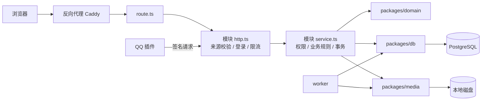

# ArtZoo 架构

本文介绍代码怎么分层、一个请求怎么流转、关键数据规则落在哪里、后台任务做什么，以及有哪些配置开关。业务结构基于代码版本 `fa643541` 整理；第九节的部署架构以当前配置模板和脚本为准，操作步骤见部署手册。

业务规则（例如退出扣几分）不在本文范围内，请看 `rules/`。

---

## 一、模块

| 位置 | 职责 | 依赖 |
|---|---|---|
| `apps/web` | Next.js 页面、全部 API 接口、服务端业务逻辑与鉴权 | domain、db、media |
| `apps/worker` | 独立的后台进程，每 30 秒运行一轮维护任务 | domain、db、media |
| `packages/domain` | 前后端共用的类型、校验、错误码、北京时间等规则 | 无 |
| `packages/db` | Prisma 数据库结构与迁移、数据库连接、各类维护任务、抽奖资格、QQ 投递队列 | domain |
| `packages/media` | 图片解码、去除元数据、本地存储、孤儿图片清理 | domain、db |
| `plugins/astrbot_plugin_artzoo` | QQ 机器人插件（Python），通过带签名的接口和网站通信 | 独立运行 |

### `apps/web` 内部的分层

- `app/api/**/route.ts`：只负责把请求转给对应模块，不写业务逻辑。
- `server/<模块>/http.ts`：校验请求来源、读取请求体、检查登录、限流、把错误转成 HTTP 响应。
- `server/<模块>/service.ts`：业务规则、权限与归属判断、数据库事务。

这是各模块约定俗成的写法，并不是框架强制的结构。新增功能时，参照同一个模块里已有的代码来写。

### 页面路由分组

括号目录不会出现在网址里。

| 位置 | 作用 |
|---|---|
| `app/layout.tsx` | 根布局：AntD 样式注册、全站 Provider；默认不允许搜索引擎收录 |
| `app/(site)/layout.tsx` | 站点外框：背景、公告栏、"跳到正文"链接 |
| `app/(site)/(public)/` | 不需要登录的页面：首页、资源、精选、登录、邀请注册 |
| `app/(site)/(protected)/` | 需要登录的页面：活动、相册、日常、知识库、抽奖、心愿、成员、固定队、个人中心、后台 |
| `app/help-demo` | 使用引导的演示页，不在上面任何分组里 |

`(protected)` 分组的布局只负责读取会话、把会话传给前端，**它本身不会拦截未登录的访问**。真正的拦截靠每个页面自己调用 `server/auth/page-guards.ts` 里的守卫函数：

- `requirePageAccount`：要求已登录。
- `requirePageAdministrator`：要求是管理员。
- `requirePageSuperAdministrator`：要求是超级管理员。

目前这一组下的 50 个页面都调用了守卫。

---

## 二、请求怎么流转

以写操作（POST/PUT/PATCH/DELETE）为例，`http.ts` 会按顺序做以下几件事：

1. **来源校验**：调用 `validateOrigin`（在 `server/auth/http.ts`），以下条件必须全部满足：
   - `Origin` 等于站点配置的地址；
   - 请求头带有 `x-artzoo-request: 1`；
   - `Sec-Fetch-Site` 不是 `cross-site`；
   - `Content-Type` 是 `application/json`。

   上传接口使用各模块自己的同类校验函数。
2. **读取请求体**：每个模块都有大小上限，比如账号模块是 8 KB。
3. **读取会话**：从 Cookie 中取出 token，到数据库查会话，并检查账号是否已被停用。
4. **限流**：来源 IP 由 `resolveRequestSource` 确定。
5. **调用 service**：在 service 里判断权限和归属，然后执行事务。

`/api/health` 是唯一不经过上述流程的接口。

### 登录、会话与权限

- **两套身份互相独立**：参与身份 `membership` 分为正式成员（MEMBER）和朋友（FRIEND）；管理角色 `adminRole` 分为 NONE、ADMIN、SUPER_ADMIN。不能从参与身份推出管理权限。
- **密码**：用 scrypt 哈希保存，比对时用 `timingSafeEqual`。如果手机号不存在，也会拿一个假哈希完整比对一遍，让响应时间和存在时一样。
- **会话**：token 随机生成，数据库里只存它的哈希，有效期 30 天。改密码或重置密码后，该账号的所有会话都会作废。
- **Cookie**：始终带 `HttpOnly` 和 `SameSite=Lax`。
  - 生产环境要求站点地址是 https，Cookie 名为 `__Host-artzoo-session`，并带 `Secure`。
  - 本地开发时只允许 localhost 访问，Cookie 名为 `artzoo-session`。
  - `ARTZOO_DEPLOYMENT_ENV` 只能是 `production` 或 `local`，填其他值时服务直接返回 503。
- **邀请链接**：数据库保存 token 的摘要。如果配置了 `ARTZOO_INVITATION_KEY`，还会额外保存一份 AES-256-GCM 加密的密文，这样管理员之后还能再次查看这条链接。
- **短信**：`ARTZOO_SMS_PROVIDER` 默认是 `unconfigured`，这时发短信的接口返回 503。目前只支持阿里云号码认证服务（`aliyun-pnvs`）。
- **页面守卫与接口鉴权要分开看**：前端把按钮隐藏，不等于有了权限控制。每个接口都必须在服务端自己检查。

### 限流

限流记录保存在数据库表 `AccountRateEvent` 里，按 15 分钟一个窗口计数：

| 桶 | 上限 |
|---|---|
| 同一来源的写操作 | 300 次 |
| 同一账号的写操作 | 60 次 |
| 全站写操作 | 10000 次 |
| 同一手机号 + 同一来源的登录 | 10 次 |
| 同一手机号的登录 | 50 次 |

"来源"由 `server/auth/request-source.ts` 决定：

- 只有在 `ARTZOO_TRUSTED_PROXY=caddy` 时，才读取 `X-Forwarded-For` 的**最后一段**作为来源。IPv4 按单个地址计算，IPv6 按 /64 网段计算。
- 其他情况下，所有人都算作同一个来源 `untrusted-source`，**全站共用一个桶**。

Caddy 部署通过 web 专用 Compose 覆盖文件设置 `ARTZOO_TRUSTED_PROXY=caddy`，并验证代理覆盖 `X-Forwarded-For`；配置关系见第九节。

### 安全响应头

定义在 `apps/web/security-headers.ts`，对所有页面生效：

- `default-src 'self'`
- `script-src 'self' 'unsafe-inline'`（没有使用 nonce）
- `img-src 'self' data: blob:`
- `frame-ancestors 'self'`
- `X-Frame-Options: SAMEORIGIN`
- `Referrer-Policy: no-referrer`
- `X-Content-Type-Options: nosniff`

### 错误与日志

- **业务错误**：抛出 `AccountError`，带错误码、中文提示和 HTTP 状态码。
- **意料之外的错误**：由 `server/http-error-log.ts` 的 `logUnexpectedHttpError` 输出一行 JSON 日志，只记录路由名、错误名和错误码。不记录 message、stack、请求体、手机号或 token。
- **Next 自身的请求错误**：通过 `instrumentation.ts` 也走同一个函数。

---

## 三、数据库

### 连接

- 数据库客户端只能通过 `getDatabase()`（在 `packages/db/src/index.ts`）获取，它在进程内只创建一次。
- 连接池参数在 `packages/db/src/pool-health.ts`：

| 参数 | 值 |
|---|---|
| 连接数上限 | `PG_POOL_MAX`，默认 web 10、worker 3 |
| 获取连接超时 | 3 秒 |
| 单条语句超时 | 15 秒 |
| 等锁超时 | 10 秒 |
| 事务空闲超时 | 30 秒 |
| `application_name` | `artzoo-web` / `artzoo-worker` |
| 会话时区 | 强制 UTC |

- `/api/health` 复用同一个连接池做 3 秒探测，只返回 `{ ok: true/false }`。

### 事务与锁

- **写事务**：统一使用 `ReadCommitted` 隔离级别，`maxWait` 5 秒，`timeout` 15 秒。**只读的列表和快照**多数使用 `RepeatableRead`。
- **锁**：同一对象的并发修改，用 `lock(tx, '类型:id')` 串行处理，底层是 PostgreSQL 的 `pg_advisory_xact_lock`；只读路径用 `lockShared`。这两个函数定义在 `apps/web/server/auth/service.ts`。`packages/db` 里的维护任务各自有一份私有的同名函数，使用同一个哈希命名空间。
- **重试**：`packages/db/src/transaction-retry.ts` 遇到死锁或序列化冲突时会自动重试，但调用方必须显式声明"这个事务可以安全地重放"。目前只有限流使用了它。
- 设计取舍见 [ADR-0001](adr/0001-postgresql-coordination.md)。

### 只写在迁移 SQL 里的规则

有些规则 `schema.prisma` 表达不了，只能写在迁移的 SQL 里。改动下表中的任何一项，都要先找到对应的 SQL 看清楚：

| 规则 | 实现 |
|---|---|
| 每人在同一个活动里，最多只有一条有效报名 | 部分唯一索引 `ActivityRegistration_active_account_key`（`WHERE status='ACTIVE'`）。固定队有同类的 `TeamMembership_active_account_key` |
| 报名的席位必须属于这个活动或这支队伍 | 复合外键 `ActivityRegistration_seatId_activityId_fkey`、`TeamMembership_seatId_teamId_fkey`、`TeamApplication_seatId_teamId_fkey` |
| 积分每次变动都留流水，不重复计分 | 表 `ActivityScoreChange`：`eventKey` 唯一，处罚和完成记录各自唯一，并记录变动前后的值。`packages/db/src/activity-standing.ts` 先锁住账号行，再更新积分 |
| 已发布的抽奖参数和开奖结果不能改 | 触发器 `Lottery_immutable`，加上"已开奖时必须有结果"的 CHECK 约束。函数定义在初始迁移 `20261111000000_init` 里，其中包含"违规删除"这一种允许的变更 |
| 抽奖资格依据开奖那一刻的历史记录 | 表 `LotteryAccountFact` 等，配有一组禁止修改、禁止删除的触发器。详见 [ADR-0002](adr/0002-immutable-lottery-results.md) |

### 规模与约定

- 127 个 model、16 个 enum。旧站的 68 个迁移已在阶段 3 合并为一个初始迁移 `20261111000000_init`；完整结构（含上表这些规则）另记在 `packages/db/prisma/schema-snapshot.txt`，数据库测试会检查两者一致。
- 所有时间字段都是 `timestamptz`。
- 外键默认是 `Restrict`，删除业务数据时，多数情况用"删除标记"代替真正的物理删除。

---

## 四、后台任务（worker）

入口是 `apps/worker/src/index.ts`，每 30 秒运行一轮。每一步单独执行：某一步失败会被记录到 `failedSteps`，下一步照常执行。

| 步骤 | 做什么 | 开关 |
|---|---|---|
| activity | 处罚点数自然减免；缺人的活动到点自动取消；长期活动的首期成团或取消；自动记未到场；活动正常完成后减分 | 始终运行 |
| lottery | 把符合资格的人自动纳入抽奖；到时间开奖；补发没有发出去的结果通知 | 始终运行 |
| officialEvents | 采集官方活动，放进待审核列表 | `ARTZOO_OFFICIAL_SYNC_ENABLED=1`，默认关；采集间隔固定 24 小时 |
| mediaReservations | 清理已经过期的图片上传预留 | `ARTZOO_MEDIA_BUDGET_ENABLED=1`，默认关 |
| mediaOrphans | 删除没有挂到任何内容上的图片 | 预算开关和 `ARTZOO_MEDIA_CLEANUP_EXECUTE=1` 都打开才运行，默认关 |
| cleanup | 每天一次：删除 1 天前的限流记录，以及过期或作废超过 7 天的会话和验证码 | `ARTZOO_SECURITY_CLEANUP_ENABLED=1`，默认关 |

- **停止**：收到 SIGINT 或 SIGTERM 后，worker 会先等当前这一轮跑完，再断开数据库连接，然后退出。
- **运行参数**：`--once` 只运行一轮；`--require-db` 表示没有配置数据库时直接报错退出。
- **QQ 消息不由 worker 发送**：由 QQ 插件主动来网站领取，见第六节。

---

## 五、图片与文件

- **存储位置**：只用服务器本地磁盘，见 `DECISIONS.md` 第 2 条。
  - 生产环境默认写到 `/app/storage/original/<类别>`（原图）和 `/app/storage/derived/<类别>`（缩略图、预览图）。每个类别都可以用 `ARTZOO_<类别>_ORIGINAL_DIR` / `_DERIVED_DIR` 单独指定。
  - 头像目录用 `ARTZOO_AVATAR_DIR` 指定，必须是绝对路径。**生产环境一定要设置它**，否则会退回到仓库下的 `.local/avatars`。
- **删除后的文件**：相册照片被删除（单张、批量或整个相册）后，原图、预览图、缩略图三个文件也会被删掉，仍是其他相册封面的照片除外。开着上传配额时先核对文件是不是当初上传的那个再删，并把容量还给配额；配额关着时按照片 ID 直接删。删除失败的照片可以在相册里查看进度并重试（`albums/service.ts`、`packages/media/src/stock-retirement.ts`）。
- **上传并发**：`withUploadSlot` 控制同时上传的请求数，用 `ARTZOO_UPLOAD_CONCURRENCY` 设置，范围 1–8，默认 2，超过时返回 503。`withPhotoSlot` 控制同时进行的图片解码，固定为 2。
- **校验与处理**：
  - 按文件头判断格式，不接受 SVG。
  - sharp 处理时设置了像素上限和超时。
  - 单张照片最大 30 MB，头像最大 10 MB。
- **去除元数据**：原图保存前，用 `packages/media/src/metadata-strip.ts` 去掉 EXIF、GPS 等信息，只保留图片方向。
- **读取**：每次读取图片都要先经过业务权限检查。私有图片的响应头是 `Cache-Control: no-store`。
- **上传配额**：开启 `ARTZOO_MEDIA_BUDGET_ENABLED` 后才生效，默认全站总量 10 GB，每天 2 GB（按北京时间计算日期）。

---

## 六、QQ 机器人

- **网站这一侧**（`server/qq-official`、`server/bot-management`、`packages/db/src/qq-official-notifications.ts`）负责：账号绑定、在群里报名时的事务处理、通知排队、签名校验。
- **插件这一侧**（`plugins/astrbot_plugin_artzoo`）定时向网站领取待发送的消息，调用 QQ 发送，然后把结果回报给网站。
- **防止重复发送**：
  - 领取消息时有 30 秒租约和版本号（fence）。
  - 插件在本地 SQLite 账本里记录每一次发送。
  - 如果发送结果不确定，标记为 UNKNOWN，**不会自动重发**。

  详见 [ADR-0003](adr/0003-qq-uncertain-delivery.md)。
- **通信安全**：所有请求都使用 HMAC-SHA256 签名，并带时间窗口和 nonce 去重。密钥是 `ARTZOO_QQ_BRIDGE_SECRET`。
- **默认关闭**：`ARTZOO_QQ_MODE` 默认未设置。真实发送需要同时满足多项配置，见第八节。

---

## 七、公开页面与搜索引擎

- **robots**（`app/robots.ts`）：只允许搜索引擎收录首页和资源页，以及它们需要用到的静态资源，其他页面一律禁止收录。注意 robots 只是告诉搜索引擎别收录，并不是访问控制。
- **分享卡片（OG）信息**：`server/public-metadata` 只为游客本来就能看到的精选照片生成。它以游客身份读取数据，不带任何会话；读取失败时，返回不允许收录的通用信息。站点地址只读 `ARTZOO_PUBLIC_ORIGIN`。

---

## 八、配置开关一览

| 变量 | 默认 | 说明 |
|---|---|---|
| `ARTZOO_DEPLOYMENT_ENV` | 无 | 只能是 `production` 或 `local` |
| `ARTZOO_PUBLIC_ORIGIN` | 无 | 站点地址，生产环境必须是 https |
| `ARTZOO_TRUSTED_PROXY` | 空 | Caddy 部署通过 web 专用 Compose 覆盖文件设为 `caddy` |
| `ARTZOO_INVITATION_KEY` | 无 | 独立随机 32 字节的规范 Base64 编码（44 字符）；缺失或格式错误时无法生成邀请链接 |
| `ARTZOO_SMS_PROVIDER` | `unconfigured` | web 设为 `aliyun-pnvs` 并完整配置下列字段才启用；worker、tools 固定关闭 |
| `ARTZOO_SMS_ACCESS_KEY_ID` / `ARTZOO_SMS_ACCESS_KEY_SECRET` | 空 | 阿里云短信凭证，仅传给 web，作为秘密处理 |
| `ARTZOO_SMS_SIGN_NAME` | 空 | 短信签名；开启短信时必填 |
| `ARTZOO_SMS_REGISTER_TEMPLATE_CODE` / `ARTZOO_SMS_RESET_TEMPLATE_CODE` | 空 | 开启短信时分别必须是 `100001` / `100003` |
| `AUTH_SMS_DAILY_LIMIT` | 200 | 全站每日短信预约上限，北京时间自然日，整数 1–10000；失败发送和虚拟预约也占额 |
| `ARTZOO_MEDIA_GLOBAL_LIMIT_BYTES` / `ARTZOO_MEDIA_DAILY_LIMIT_BYTES` | 10000000000 / 2000000000 | 正整数字节数，不超过有符号 64 位整数上限；每日不得超过全站 |
| `ARTZOO_AVATAR_DIR` | 仓库下的 `.local/avatars` | 生产环境必须设置为绝对路径 |
| `ARTZOO_UPLOAD_CONCURRENCY` | 2 | 同时上传的请求数，范围 1–8 |
| `ARTZOO_MEDIA_BUDGET_ENABLED` | 关 | 上传配额 |
| `ARTZOO_MEDIA_CLEANUP_EXECUTE` | 关 | 真正删除孤儿图片 |
| `ARTZOO_SECURITY_CLEANUP_ENABLED` | 关 | 每天清理过期的认证记录 |
| `ARTZOO_OFFICIAL_SYNC_ENABLED` | 关 | 自动采集官方活动 |
| `ARTZOO_QQ_MODE` | 未设置，即关闭 | `simulation`（只能在本地使用）或 `live`。`live` 模式还需要真实发送开关、测试群确认、APP_ID / BOT_ID / 群 openid、启用时间等多项配置，详见 `packages/db/src/qq-official-config.ts` |
| `ARTZOO_QQ_BRIDGE_SECRET` | 无 | 网站和插件之间通信用的签名密钥 |
| `PG_POOL_MAX` | web 10 / worker 3 | 数据库连接数上限 |

本表列通用默认值；部署配置关系见第九节，实际配置步骤见[部署配置操作手册](DEPLOYMENT.md)。

---

## 九、部署镜像与交付

部署决定见 [DECISIONS.md](DECISIONS.md) 第 8–12 条；安装、配置、构建、验收、启停和回退步骤统一见[部署配置操作手册](DEPLOYMENT.md)。

### 运行布局

- **Dev**：保留源码并构建镜像，Docker 使用 rootless 与独立网络，避免覆盖 Server 的防火墙规则。Docker 下载代理通过用户服务配置；构建步骤使用 `ARTZOO_BUILD_PROXY`，代理不写入运行镜像环境。家庭代理配置允许 Dev 容器访问宿主回环服务。
- **Server**：安装 Caddy、Docker 和 Docker Compose，接收版本化发布包，不拉取源码，也不需要宿主 Node、pnpm 或 Python。web、worker、PostgreSQL 由 Compose 管理；tools 只用于显式维护。
- **Windows**：WSL 使用 mirrored、DNS 隧道、自动代理及本机 IP 回环；宿主防火墙将家庭入口限定为指定局域网到 TCP 443。Windows 不安装 Caddy，不配置家庭公网端口映射。
- **正式服务器**：沿用镜像发布方式；独立 Linux 服务器不需要 WSL 配置，域名入口使用单独的 Caddy 模板。

### HTTPS 与代理

访问链路为固定局域网地址的 HTTPS → Server Caddy → `127.0.0.1:13100` → web 容器 `3100`。worker 不发布端口；PostgreSQL 只接内部网络、不发布宿主端口；Caddy 管理接口仅监听回环地址。

家庭入口使用 Caddy 内部 CA，当前允许设备证书警告，设备信任状态单独记录。正式域名模板使用自动 HTTPS；证书和私钥保存在 Server，不进入仓库或发布包。

Caddy 覆盖转发头；应用仅在 `ARTZOO_TRUSTED_PROXY=caddy` 时信任来源。基础环境配置保持该值为空，由 `/srv/artzoo/deploy/proxy.compose.yaml` 仅为 web 启用。维护脚本自动加载并校验覆盖文件，拒绝额外服务、字段或不可信文件。

### 镜像与发布包

| 镜像 | 内容与用途 |
|---|---|
| web | Next standalone、静态资源、独立 BMP 线程及生产依赖 |
| worker | 编译后的后台程序及生产依赖，默认要求数据库配置 |
| tools | Prisma CLI、迁移、媒体基线和受保护的超管初始化入口；默认只显示说明 |

应用镜像统一使用锁文件和固定 Node 基础镜像，默认以 UID/GID 1000 运行。`.dockerignore` 排除宿主依赖、私有配置、密钥和运行数据；Compose 仅引用镜像，不挂源码、不执行构建。

| 发布包内容 | 文件或用途 |
|---|---|
| 镜像与清单 | `images.tar`、`images.tsv`、`source.txt`、`SHA256SUMS` |
| 运行配置 | `compose.yaml`、`.env.example`、`runtime-config.manifest`、由镜像清单生成的 `images.env` |
| 构建与验收工具 | `deployment-images.sh`、`deployment-image-check.mjs`、`deployment-compose-check.sh`、`deployment-https-check.mjs` |
| 维护入口 | `deployment-maintenance.sh` |
| 配置模板 | 七份 Caddy、代理覆盖、WSL 网络及 Dev Docker 配置模板，源文件位于 `deployment/` |
| 操作手册 | `DEPLOYMENT.md` |

发布包输出到仓库外的独立版本目录，交付文件逐项纳入 SHA-256 校验；导入还核对镜像 ID 和平台，不替换同名不同内容的镜像。校验和用于完整性检查，发布包仍须来自可信开发端。PostgreSQL 官方镜像单独准备，不包含在三个应用镜像中。

正式候选包来自干净工作区；允许未提交改动或仅构建部分镜像时使用 `dev-` 标签。完整 Compose 和维护流程需要三个镜像；发布包导入不切换正在运行的网站。

### 运行配置清单

`deployment/runtime-config.manifest` 随发布包交付并参与 SHA-256 校验。每行用 `|` 分隔变量名、必填条件、秘密标记、校验规则、默认值、目标服务；`fixed` 行描述不可由环境文件覆盖的容器策略，`-` 表示仅供宿主使用。新增常规运行变量只需修改清单与 `compose.yaml`，不再修改维护脚本的变量白名单。

环境文件只接受清单声明的输入变量。可选项未提供或为空时使用清单与 Compose 中一致的默认值；短信的五个字段在 `aliyun-pnvs` 下全部必填，关闭时必须为空。普通值使用 `NAME=value`；含 `$`、`#`、引号或反斜杠时使用单引号包裹，内部单引号写作 `\'`。不接受末尾反斜杠、反斜杠紧邻单引号的值、双引号插值、多行值、行尾注释或首尾空白；不会执行文件内容。

只读命令 `bash "$bundle/deployment-maintenance.sh" config-check --bundle "$bundle" --root "$root"` 校验发布包及配置，汇总缺失、多余和格式不符的变量名，不显示值，不连接 Docker、不创建锁或临时文件。它不代表镜像已导入、代理已验收或短信已发送成功。实际维护仍核对镜像 ID、挂载和代理覆盖；`check_app` 按清单比较所有声明的非秘密容器变量，秘密仅在读取配置时校验格式。

web、worker 使用 `json-file` 容器日志，每个文件最多 `10m`，最多保留 `3` 个；维护检查会核对实际日志设置。tools 使用 `none`，不持久记录初始化交互。语法依据 [Docker 日志配置](https://docs.docker.com/reference/compose-file/services/#logging)及[环境文件插值规则](https://docs.docker.com/compose/how-tos/environment-variables/variable-interpolation/)。

### 持久化与维护

| 数据或配置 | Server 位置 | 约束 |
|---|---|---|
| PostgreSQL 数据 | `artzoo_postgres-data` named volume | 固定 Compose 项目名，重建容器保留数据卷 |
| 原图、衍生图、头像 | `/srv/artzoo/media/{original,derived,avatars}` | UID/GID 1000、目录 0700；web、worker、tools 共用 |
| 秘密配置 | `/srv/artzoo/secrets/compose.env` | 文件 0600、secrets 目录 0700，不随包传输 |
| 代理覆盖 | `/srv/artzoo/deploy/proxy.compose.yaml` | 仅覆盖 web 的代理信任配置，文件及上级目录不可被组或其他用户写入 |
| Caddy 配置与状态 | `/etc/caddy/Caddyfile`、`/var/lib/caddy/` | 配置、证书和私钥留在 Server；模板单独入库 |
| 发布包 | `/srv/artzoo/releases/<版本>` | 保留旧版本，不原地修改已校验的包 |

媒体使用 Linux 文件系统；目录及祖先须属于 root 或运行用户，不能被组或其他用户写入。Compose 拒绝缺失的挂载目录，不自动创建或放宽权限。

迁移、媒体基线和首位超管初始化均为显式维护，不随网站启动执行。配额须在基线完成后启用；worker 开启认证记录清理，孤儿媒体删除、官方采集和 QQ 固定关闭；短信默认关闭，仅 web 可按清单启用。维护入口核对发布包、镜像及运行配置；日常启停保留数据，不执行初始化或升级。

### 验证与边界

- 镜像和 Compose 检查使用独立临时资源，覆盖运行依赖、空库迁移、媒体基线、worker、挂载和持久化；不连接家庭数据库。
- HTTPS 检查核对证书、健康接口和伪造转发头，结束后恢复临时修改的 Caddy 配置；多设备访问与入口隔离按部署手册验收。
- 初始化、服务健康和 HTTPS 可用不等于登录、上传、权限或备份恢复验收完成。容器重启策略不代替 Windows/WSL 开机恢复；任务状态统一以 [PLAN.md](PLAN.md) 为准。
