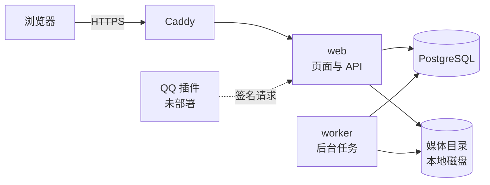
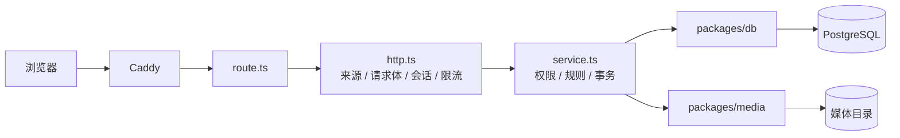
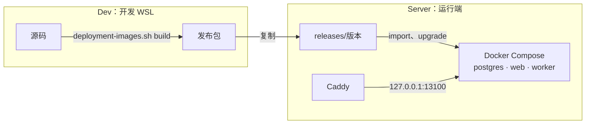

# ArtZoo 架构

本文回答四个问题：网站由哪几部分组成、一次请求怎么被处理、重要规则写在哪里、网站在服务器上怎么运行。读者是站长（了解全貌）和 AI 助手（改代码前确认约束）。

| 想了解 | 去看 |
|---|---|
| 业务规则（例如退出扣几分） | `rules/` |
| 界面规范 | `design/ui-guidelines.md` |
| 发版、备份、恢复的操作步骤 | [DEPLOYMENT.md](DEPLOYMENT.md) |
| 重要设计为什么这样做 | [adr/](adr/) |

本文描述当前代码。发现和代码对不上时，先报告站长，由站长决定改文档还是改代码。

---

## 一、全景

- **web**：Next.js 应用，包含全部页面、全部 API 和服务端业务逻辑。
- **worker**：独立的后台进程，循环执行活动结算、开奖、清理等任务（第六节）。
- **PostgreSQL**：唯一的数据库。web 和 worker 之间的并发协调也在数据库里完成，不用 Redis 或消息队列（[ADR-0001](adr/0001-postgresql-coordination.md)）。
- **媒体目录**：上传的图片和头像直接存在服务器磁盘上，不用云存储（DECISIONS 第 2 条）。
- **QQ 插件**：Python 写的 AstrBot 插件，主动来网站领取待发消息。代码在仓库里，但目前没有部署，生产配置里 QQ 功能固定关闭。

---

## 二、代码目录

| 位置 | 内容 | 依赖 |
|---|---|---|
| `apps/web` | Next.js（App Router）页面、API、服务端业务与鉴权 | domain、db、media |
| `apps/worker` | 后台任务进程，入口 `src/index.ts` | domain、db、media |
| `packages/domain` | 前后端共用的类型、校验、错误码、北京时间工具 | 无 |
| `packages/db` | Prisma 结构与迁移、数据库连接、各类维护任务、抽奖资格、QQ 投递队列、媒体配额记账 | domain |
| `packages/media` | 图片解码与处理、去元数据、本地存储、文件身份、孤儿清理 | domain、db |
| `plugins/astrbot_plugin_artzoo` | QQ 机器人插件（Python） | 独立运行 |
| `deployment/`、`scripts/deployment-*` | 部署模板与维护脚本 | 不参与网站运行 |
| `tests/` | 全部测试，说明见 `tests/README.md` | — |

依赖的确切版本以 `pnpm-lock.yaml` 为准。

### `apps/web` 内部分三层

| 层 | 位置 | 只做什么 |
|---|---|---|
| 路由 | `app/api/**/route.ts` | 把请求转给对应模块，不写业务逻辑 |
| HTTP 适配 | `server/<模块>/http.ts` | 校验请求来源、读请求体、取会话、限流、把错误转成 HTTP 响应 |
| 业务 | `server/<模块>/service.ts` | 权限与归属判断、业务规则、数据库事务 |

这是约定，不是框架强制的。新增功能时照着同一模块里已有的代码写；写接口的具体要求见 `apps/web/server/AGENTS.md`。

### 页面分组与登录守卫

括号目录不会出现在网址里。

| 位置 | 作用 |
|---|---|
| `app/layout.tsx` | 根布局：AntD 样式、全站 Provider；默认禁止搜索引擎收录 |
| `app/(site)/layout.tsx` | 站点外框：背景、公告栏、"跳到正文"链接 |
| `app/(site)/(public)/` | 不用登录的页面：首页、资源、精选、登录、邀请注册 |
| `app/(site)/(protected)/` | 要登录的页面：活动、相册、日常、知识库、抽奖、心愿、成员、固定队、个人中心、后台 |
| `app/help-demo` | 使用引导的演示页 |

注意：`(protected)` 的布局只负责读取会话，**它本身不拦截未登录访问**。拦截靠每个页面自己调用 `server/auth/page-guards.ts` 里的守卫：`requirePageAccount`（要登录）、`requirePageAdministrator`（要管理员）、`requirePageSuperAdministrator`（要超级管理员）。目前这个分组下的页面都调用了守卫，新增页面时不能漏。

页面守卫只管"能不能打开页面"。前端隐藏按钮不算权限控制，每个接口都必须在服务端自己检查权限。

---

## 三、一次请求怎么处理

写操作（POST、PUT、PATCH、DELETE）在进入业务逻辑前要过这几关：

1. **来源校验**：JSON 请求调用 `validateOrigin`（`server/auth/http.ts`），必须同时满足：`Origin` 等于站点地址；带请求头 `x-artzoo-request: 1`；`Sec-Fetch-Site` 不是 `cross-site`；`Content-Type` 是 `application/json`。上传接口用各模块自己的同类校验函数。
2. **读请求体**：每个模块都有大小上限，例如账号模块 8 KB。
3. **取会话**：从 Cookie 取 token，到数据库查会话，同时确认账号没有被停用。
4. **限流**：来源 IP 只能用 `resolveRequestSource` 取得（见第四节）。
5. **业务处理**：service 在事务里加锁、重新读数据，再判断权限和归属。

现有模块里第 2、3 步的先后不完全一样（例如活动模块先读请求体，上传接口先确认登录和额度再读文件）。新写接口按 `apps/web/server/AGENTS.md` 的要求来。

`/api/health` 是唯一不经过这些步骤的接口：用同一个连接池做 3 秒探测，只返回 `{ ok: true }` 或 `{ ok: false }`。

---

## 四、账号与安全

### 身份与登录

- **两套身份互相独立**：参与身份 `membership` 是正式成员（MEMBER）或朋友（FRIEND）；管理角色 `adminRole` 是 NONE、ADMIN 或 SUPER_ADMIN。不能从参与身份推出管理权限。
- **密码**：scrypt 哈希，比对用 `timingSafeEqual`。手机号不存在时也拿一个假哈希完整比对一遍，让响应时间一致。
- **会话**：token 随机生成，数据库只存哈希，有效期 30 天。改密码或重置密码后，该账号所有会话作废；账号被停用后会话立即失效。
- **Cookie**：始终 `HttpOnly`、`SameSite=Lax`。生产环境要求站点地址是 https，Cookie 名 `__Host-artzoo-session` 并带 `Secure`；本地开发只允许 localhost，Cookie 名 `artzoo-session`。`ARTZOO_DEPLOYMENT_ENV` 只能是 `production` 或 `local`，其他值一律返回 503。
- **邀请链接**：数据库保存 token 的摘要，以及一份用 `ARTZOO_INVITATION_KEY` 加密（AES-256-GCM）的密文，所以管理员之后还能再次查看链接。这个密钥是必需的：缺失或格式不对时，生成和查看邀请都返回 503。
- **短信**：只支持阿里云号码认证服务（`aliyun-pnvs`）。`ARTZOO_SMS_PROVIDER` 默认 `unconfigured`，这时不会发出任何短信，注册和找回密码都无法完成。全站每天的发码次数受 `AUTH_SMS_DAILY_LIMIT` 限制（默认 200）。
- 账号模块的高风险约束和更多实现细节见 `apps/web/server/auth/AGENTS.md` 与同目录 `README.md`。

### 限流

记录存在表 `AccountRateEvent`，每个桶按 15 分钟窗口计数：

| 桶 | 上限 |
|---|---|
| 同一来源的写操作 | 300 |
| 同一账号的写操作 | 60 |
| 全站写操作 | 10000 |
| 同一来源的登录 | 30 |
| 同一手机号 + 同一来源的登录 | 10 |
| 同一手机号的登录 | 50 |

"来源"由 `server/auth/request-source.ts` 决定：只有 `ARTZOO_TRUSTED_PROXY=caddy` 时，才取 `X-Forwarded-For` 的**最后一段**（IPv4 按单个地址，IPv6 按 /64 网段）；否则所有人都算同一个来源 `untrusted-source`，**全站共用一个桶**。部署时只有 web 通过代理覆盖文件打开这个开关（第十节）。

### 安全响应头

定义在 `apps/web/security-headers.ts`，对所有页面生效。要点：`default-src 'self'`；`script-src 'self' 'unsafe-inline'`（没有用 nonce）；`img-src 'self' data: blob:`；`frame-ancestors 'self'`；另有 `X-Frame-Options: SAMEORIGIN`、`Referrer-Policy: no-referrer`、`X-Content-Type-Options: nosniff`。

### 错误与日志

- **业务错误**：抛 `AccountError`，带错误码、中文提示和 HTTP 状态码。
- **意外错误**：`server/http-error-log.ts` 的 `logUnexpectedHttpError` 输出一行 JSON，只含路由名、错误名和错误码；不记录 message、stack、请求体、手机号或 token。Next 自身的请求错误通过 `instrumentation.ts` 走同一个函数。

---

## 五、数据库

### 连接

数据库客户端只能通过 `getDatabase()`（`packages/db/src/index.ts`）获取，进程内只建一次。连接池参数在 `packages/db/src/pool-health.ts`：

| 参数 | 值 |
|---|---|
| 连接数上限 | `PG_POOL_MAX`，web 10、worker 3 |
| 获取连接超时 | 3 秒 |
| 单条语句超时 | 15 秒 |
| 等锁超时 | 10 秒 |
| 事务空闲超时 | 30 秒 |
| 会话时区 | 强制 UTC |

### 事务与锁

- **写事务**统一用 `ReadCommitted`，`maxWait` 5 秒、`timeout` 15 秒；只读的列表和快照多数用 `RepeatableRead`。
- **锁**：同一对象的并发修改用 `lock(tx, '类型:id')` 串行处理（底层是 `pg_advisory_xact_lock`），只读路径用 `lockShared`。两个函数在 `apps/web/server/auth/service.ts`；`packages/db` 的维护任务各有一份同名私有函数，使用同一个哈希命名空间。
- **重试**：`packages/db/src/transaction-retry.ts` 遇到死锁或序列化冲突会重试，但调用方必须声明"这个事务可以安全重放"。目前只有限流用了它。
- 设计取舍见 [ADR-0001](adr/0001-postgresql-coordination.md)。

### 只写在迁移 SQL 里的规则

下面这些规则 `schema.prisma` 表达不了，只存在于迁移 SQL 里。改动相关功能前，先找到对应的 SQL 看清楚：

| 规则 | 实现 |
|---|---|
| 每人在同一活动最多一条有效报名 | 部分唯一索引 `ActivityRegistration_active_account_key`（`WHERE status='ACTIVE'`）；固定队同类索引 `TeamMembership_active_account_key` |
| 报名的席位必须属于这个活动或这支队伍 | 复合外键 `ActivityRegistration_seatId_activityId_fkey`、`TeamMembership_seatId_teamId_fkey`、`TeamApplication_seatId_teamId_fkey` |
| 积分每次变动都留流水、不重复计分 | 表 `ActivityScoreChange`：`eventKey` 唯一，记录变动前后的值；`packages/db/src/activity-standing.ts` 先锁账号行再更新 |
| 已发布的抽奖参数和开奖结果不能改 | 触发器 `Lottery_immutable` 加"已开奖必须有结果"的 CHECK；唯一允许的变更是违规删除标记 |
| 抽奖资格按开奖时刻的历史判断 | `LotteryAccountFact` 等只追加的表，配有禁止修改和删除的触发器（[ADR-0002](adr/0002-immutable-lottery-results.md)） |

### 迁移与结构快照

- 迁移在 `packages/db/prisma/migrations/`：一个初始迁移 `20261111000000_init`（由旧站的 68 个迁移合并而来），之后每次结构变化新增一个，已有迁移不能修改。
- 跑完全部迁移后的完整结构（含约束、触发器、函数和初始数据）记录在 `packages/db/prisma/schema-snapshot.txt`，数据库测试会检查两者一致。改迁移的流程见 `packages/db/AGENTS.md`。
- 所有时间字段都是 `timestamptz`；外键全部是 `Restrict`（不级联删除）。内容删除一律是软删除（打标记隐藏），只有相册照片的图片文件会被物理删除，见 `rules/content-moderation.md`。

---

## 六、后台任务（worker）

入口 `apps/worker/src/index.ts`。每轮跑完后等 30 秒再跑下一轮。每一步单独执行：某一步失败会记进 `failedSteps`，不影响后面的步骤。

| 步骤 | 做什么 | 什么时候运行（生产配置） |
|---|---|---|
| activity | 处罚点数自然减免；缺人的活动到点自动取消；长期活动首期成团或取消；自动记未到场；活动正常完成后减分 | 始终 |
| lottery | 把符合条件的人纳入签到抽奖；到时间开奖；补发没发出去的结果通知 | 始终 |
| officialEvents | 采集官方活动，放进待审核列表（每 24 小时一次） | `ARTZOO_OFFICIAL_SYNC_ENABLED=1`；生产固定关闭 |
| mediaReservations | 清理过期的图片上传预留 | `ARTZOO_MEDIA_BUDGET_ENABLED=1`；生产开启 |
| mediaOrphans | 删除没有挂到任何内容上的图片 | 配额开启且 `ARTZOO_MEDIA_CLEANUP_EXECUTE=1`；生产固定关闭 |
| cleanup | 每天一次：删除 1 天前的限流记录，以及过期或作废超过 7 天的会话和验证码 | `ARTZOO_SECURITY_CLEANUP_ENABLED=1`；生产的 worker 开启 |

- 收到 SIGINT 或 SIGTERM 时，先等当前这一轮结束，再断开数据库并退出。
- 启动参数：`--once` 只跑一轮；`--require-db` 没配置数据库时直接报错退出。
- QQ 消息不由 worker 发送，而是 QQ 插件主动来领取（第八节）。

---

## 七、图片与文件

### 存储位置

- 生产环境固定写在容器内 `/app/storage/original/<类别>`（原图）、`/app/storage/derived/<类别>`（缩略图、预览图）和 `/app/storage/avatars`（头像）。这三个目录分别挂载自服务器的 `/srv/artzoo/media/{original,derived,avatars}`。
- 类别子目录：`daily`、`wishes`、`lotteries`、`knowledge`、`albums`、`official-events`。
- 文件名只用服务端生成的 UUID；写文件用独占创建、不跟随符号链接、先写临时文件再原子发布。
- 本地开发时默认写到仓库下的 `.local/`，可以用 `ARTZOO_<类别>_ORIGINAL_DIR` / `_DERIVED_DIR`、`ARTZOO_AVATAR_DIR` 改位置。

### 上传与处理

- 按文件头判断格式，不接受 SVG；sharp 处理时设了像素上限和超时。
- 单张照片最大 30 MB，头像最大 10 MB。
- 原图保存前用 `packages/media/src/metadata-strip.ts` 去掉 EXIF、GPS 等信息，只保留图片方向。
- 并发：`withUploadSlot` 限制同时上传的请求数（`ARTZOO_UPLOAD_CONCURRENCY`，1–8，默认 2，满了返回 503）；`withPhotoSlot` 限制同时解码的图片数，固定 2。
- 读取：每次读图片都先经过业务权限检查；私有图片的响应头是 `Cache-Control: no-store`。

### 上传配额

`ARTZOO_MEDIA_BUDGET_ENABLED=1` 时生效。默认全站总量 10 GB（按实际存储的所有文件计算，含缩略图），每个账号每个北京时间自然日 2 GB（按上传的原文件大小计算）。开启前必须先初始化配额基线（部署时的 `baseline` 步骤）；之后改上限不会清零已用量。

### 删除

- 相册照片被删除（单张、批量或整个相册）后，原图、预览图、缩略图三个文件也会被删掉；仍是其他相册封面的照片暂时保留文件。配额开启时，先核对文件就是当初上传并记账的那个，再删除并把容量还给配额；删除失败可以在相册里看进度并重试（`apps/web/server/albums/service.ts`、`packages/media/src/stock-retirement.ts`）。
- 其他内容是软删除，文件留在磁盘上。孤儿清理（mediaOrphans）在生产固定关闭。

### 文件身份

为了保证"删掉的正是当初那个文件"，数据库给每个磁盘文件记了一个身份指纹，里面包含文件在磁盘上的物理身份（设备号、inode 等）。从备份恢复后文件是重新写出来的，身份会变，所以**恢复或回退之后必须执行一次媒体重新登记**，登记完成前网站保持停止。设计和取舍见 [ADR-0004](adr/0004-media-file-identity.md)，操作见 DEPLOYMENT.md。

---

## 八、QQ 机器人

- **网站这一侧**（`server/qq-official`、`server/bot-management`、`packages/db/src/qq-official-notifications.ts`）：账号绑定、群里报名的事务处理、通知排队、签名校验。
- **插件这一侧**（`plugins/astrbot_plugin_artzoo`）：定时向网站领取待发消息，调用 QQ 发送，再把结果回报给网站。
- **不重复发送**：领取时有 30 秒租约和版本号（fence）；插件在本地 SQLite 账本记录每次发送；结果不确定时标记 UNKNOWN，**不自动重发**（[ADR-0003](adr/0003-qq-uncertain-delivery.md)）。
- **通信安全**：所有请求用 HMAC-SHA256 签名，带时间窗口和 nonce 去重，密钥是 `ARTZOO_QQ_BRIDGE_SECRET`。
- **默认关闭**：`ARTZOO_QQ_MODE` 未设置即关闭；`simulation` 只能在本地使用，`live` 还需要多项开关和群配置（`packages/db/src/qq-official-config.ts`）。生产部署里固定关闭。

---

## 九、公开页面与搜索引擎

- **robots**（`app/robots.ts`）：只允许收录首页、资源页和它们用到的静态资源，其他一律禁止。robots 只是告诉搜索引擎别收录，不是访问控制。
- **分享卡片（OG）**：`server/public-metadata` 只为游客本来就能看到的精选照片生成，以游客身份读取、不带会话；读取失败时返回不允许收录的通用信息。站点地址只读 `ARTZOO_PUBLIC_ORIGIN`。

---

## 十、运行与部署结构

部署相关决定见 DECISIONS 第 8–16 条，操作步骤见 [DEPLOYMENT.md](DEPLOYMENT.md)。

### 开发端构建，运行端只接收发布包

- **Dev** 有源码，负责构建发布包。家庭 Dev 的 Docker 用 rootless 模式，避免和 Server 的 Docker 互相覆盖网络规则。
- **Server** 不拉源码，也不需要 Node、pnpm、Python，只要 Docker、Docker Compose 和 Caddy。家庭 Server 是同一台 Windows 上的另一个 WSL（网络用 mirrored 模式）；正式服务器是独立的 Linux 主机。
- **发布包**是一个版本目录：三个镜像（`images.tar`）、镜像清单和校验和、`compose.yaml`、运行配置模板和配置清单、维护脚本、Caddy 等配置模板，以及 DEPLOYMENT.md。导入时逐个核对校验和、镜像 ID 和平台。PostgreSQL 官方镜像不在包里，由 Server 自行拉取。

### 容器

| 服务 | 镜像内容 | 网络与端口 |
|---|---|---|
| postgres | 官方 `postgres:17.11-bookworm` | 只接内部网络，不发布端口；数据在卷 `artzoo_postgres-data` |
| web | Next standalone、静态资源和生产依赖 | 只发布到 `127.0.0.1:13100`，由 Caddy 转发 |
| worker | 编译后的后台程序和生产依赖 | 不发布端口 |
| tools | Prisma CLI、迁移、媒体基线、媒体重新登记、首位超管初始化 | 平时不运行，只在维护命令里临时启动 |

- 应用容器以 UID/GID 1000 运行；web、worker 共用三个媒体目录。
- web、worker 的容器日志是 `json-file`，每个文件最大 10 MB、最多 3 个；tools 不记日志。
- HTTPS 链路：设备 → Caddy（家庭用固定局域网 IP 和 Caddy 内部证书，正式站用域名和自动证书）→ `127.0.0.1:13100` → web 容器的 3100 端口。Caddy 管理接口只监听本机回环地址。

### 生产环境里固定的设置

这些值写在 `deployment/compose.yaml` 和 `deployment/runtime-config.manifest` 里，`compose.env` 改不了：

- `NODE_ENV`、`ARTZOO_DEPLOYMENT_ENV` 都是 `production`；头像目录固定 `/app/storage/avatars`。
- QQ、官方活动采集、孤儿图片删除固定关闭。
- 短信只有 web 能按配置开启，worker 和 tools 固定关闭；认证记录清理只在 worker 开启。
- 连接池 web 10、worker 3。
- `compose.env` 里的 `ARTZOO_TRUSTED_PROXY` 保持空值；由 `/srv/artzoo/deploy/proxy.compose.yaml` 只给 web 设为 `caddy`。维护脚本只接受这个文件的固定四行内容。

### 维护操作都是显式的

数据库迁移、媒体基线、首位超管初始化都不会在网站启动时自动执行，只能由站长运行维护脚本完成。发版是**停服升级**：停写 → 强制备份 → 只向前迁移 → 用新镜像重建 → 健康检查；回退用"旧版本镜像 + 升级前备份"，会丢弃升级后写入的数据（DECISIONS 第 15 条）。恢复和回退后都要先完成媒体重新登记才能开站。

### Server 上的数据位置

| 内容 | 位置 |
|---|---|
| 数据库 | Docker 卷 `artzoo_postgres-data`（项目名固定为 `artzoo`，重建容器不丢数据） |
| 原图、缩略图、头像 | `/srv/artzoo/media/{original,derived,avatars}`（UID/GID 1000，目录 0700） |
| 运行配置与秘密 | `/srv/artzoo/secrets/compose.env`（0600，不随发布包传输，不进备份） |
| 发布包 | `/srv/artzoo/releases/<版本>`（保留旧版本，不修改） |
| 部署记录 | `/srv/artzoo/deploy/`（当前版本、上一版本、历史、标记文件） |
| 备份 | 默认 `/srv/artzoo/backups/` |
| Caddy 配置、证书和私钥 | `/etc/caddy/Caddyfile`、`/var/lib/caddy/` |

---

## 十一、配置项

### 运行端 `compose.env` 里能配置的

完整定义（必填条件、校验规则、默认值、传给哪些服务）在 `deployment/runtime-config.manifest`；写法规则见 DEPLOYMENT.md。

| 变量 | 默认 | 说明 |
|---|---|---|
| `COMPOSE_PROJECT_NAME` | 初始化时填 `artzoo` | 必须和维护脚本的项目名一致，它决定用哪个数据库卷 |
| `ARTZOO_MEDIA_ROOT` | 初始化时填 `/srv/artzoo/media` | 必须是站点目录下的 `media` |
| `ARTZOO_HTTP_PORT` | 13100 | web 在本机回环地址上的端口，Caddy 转发到这里 |
| `ARTZOO_PUBLIC_ORIGIN` | 初始化时按输入填写 | 站点地址，必须是精确的 https 地址，不带结尾斜杠 |
| `ARTZOO_TRUSTED_PROXY` | 空 | 保持空值，见第十节 |
| `POSTGRES_PASSWORD` | 初始化时随机生成 | 64 位十六进制。站点建好后再改它，不会改变已有数据库的密码 |
| `ARTZOO_INVITATION_KEY` | 初始化时随机生成 | 32 字节随机数的 Base64（44 个字符）；邀请链接必需 |
| `ARTZOO_MEDIA_BUDGET_ENABLED` | 0 | 上传配额。新站初始化的最后一步才设为 1；不要为了改上限而关闭 |
| `ARTZOO_MEDIA_GLOBAL_LIMIT_BYTES` | 10000000000 | 全站总量（字节） |
| `ARTZOO_MEDIA_DAILY_LIMIT_BYTES` | 2000000000 | 每个账号每天（北京时间）的上传量；不能超过全站总量 |
| `ARTZOO_SMS_PROVIDER` | `unconfigured` | 设为 `aliyun-pnvs` 开启短信，同时必须填齐下面五项 |
| `ARTZOO_SMS_ACCESS_KEY_ID`、`ARTZOO_SMS_ACCESS_KEY_SECRET` | 空 | 阿里云凭证，只传给 web，按秘密处理 |
| `ARTZOO_SMS_SIGN_NAME` | 空 | 短信签名 |
| `ARTZOO_SMS_REGISTER_TEMPLATE_CODE`、`ARTZOO_SMS_RESET_TEMPLATE_CODE` | 空 | 开启短信时必须分别是 `100001`、`100003` |
| `AUTH_SMS_DAILY_LIMIT` | 200 | 全站每天（北京时间）最多预约多少次短信，1–10000；发送失败和对未注册号码的虚拟预约也算 |

### 只在本地开发或测试中使用的

生产部署不会传入这些变量，它们要么固定为上一小节"生产环境里固定的设置"，要么使用代码默认值：

- 功能开关：`ARTZOO_QQ_MODE` 及 QQ 相关变量、`ARTZOO_OFFICIAL_SYNC_ENABLED`、`ARTZOO_MEDIA_CLEANUP_EXECUTE`、`ARTZOO_SECURITY_CLEANUP_ENABLED`。
- 存储位置：`ARTZOO_<类别>_ORIGINAL_DIR` / `_DERIVED_DIR`、`ARTZOO_AVATAR_DIR`。
- 性能与限流：`ARTZOO_UPLOAD_CONCURRENCY`（生产即默认 2）、`PG_POOL_MAX`、`AUTH_WRITE_*_LIMIT` / `AUTH_LOGIN_*_LIMIT`（覆盖第四节的限流上限）。

新增一个运行变量时，同时修改 `deployment/runtime-config.manifest` 和 `deployment/compose.yaml`；维护脚本按清单校验，不需要改脚本。
